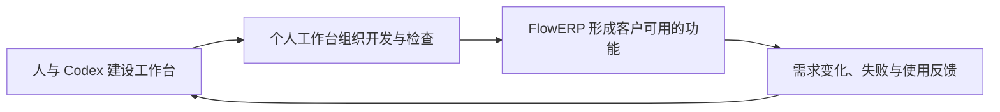
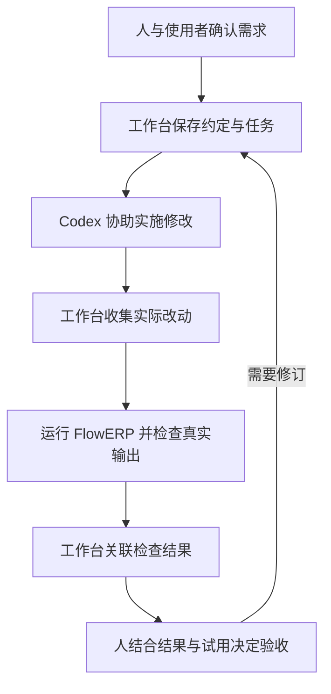
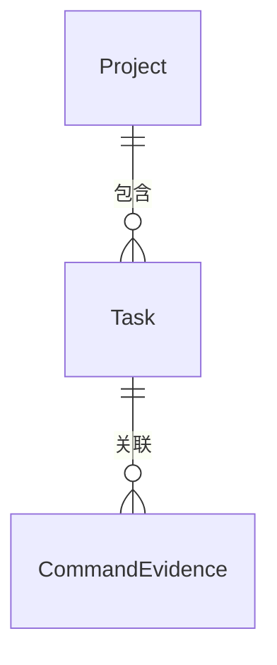
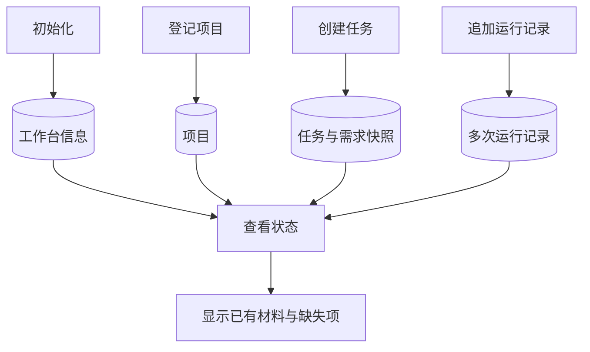

# L01｜以终为始：一次可验证的 AI 交付怎样完成？

本课程首先要交付一套个人研发工作台。我们用 Codex 建设它，再通过它持续开发电商业务系统 FlowERP。工作台积累可复用的研发能力，FlowERP 则用实际需求、失败和交付结果检验这些能力。

这一建设过程从一个问题开始：**当 AI 能够帮助我们写出程序时，还需要怎样的组织方式，才能持续交付符合要求的产品？** 第一课通过一个库存导出案例分析这个问题，再据此设计并实现工作台的起步版本。

## 本章学习地图

本讲依次讨论四件事：我们最终交付什么；为什么需要工作台；工作台怎样协同 Codex 改善交付质量；第一版应当怎样设计。完成阅读后，你应能解释设计的必要性、指出验证结论的范围，并将一个需求转成可以实际检查的程序行为。

阅读不要求已有软件架构或自动测试经验。相关概念会随问题引入。实践需要完成 [L00 环境准备](../L00-课前准备-安装工具与通过环境自检.md)，能够打开项目、编辑文件并运行给定命令；具体操作见[实践操作手册](./实践操作手册.md)。

**本讲实践成果是 Workbench V0.1：保存项目、任务与运行记录的五个操作，以及你本人确认的需求说明和建设依据。** 下文先推演工作台建成后的完整协作，再说明第一版为什么选择这个范围。L01 由你直接监督 Codex 建设工作台；L04 补齐执行与检查能力后，首次通过工作台交付 FlowERP 库存导出。

## 1. 我们最终要交付什么？

### 1.1 个人研发工作台

与 Codex 开发一个功能时，你需要提供项目背景，说明要解决的问题，判断修改是否合理，并决定结果是否可以交付。任务增加以后，这些工作会反复出现。

**个人研发工作台是组织这类开发活动的程序。** 它把一次任务的要求、执行、检查和决定关联起来，并逐步将重复步骤固定为可执行流程。它的使用者是负责开发与交付的人。


*图 1｜工作台参考成品。项目入口提供开发上下文，任务列表记录正在处理的工作，验收入口集中需要作出决定的结果。*

工作台的核心价值不止在总览页。打开某项任务时，应能查清本次采用了什么要求、做了哪些修改、运行了什么检查，以及哪些问题尚未解决。


*图 2｜参考任务的复验与审核页面。截图中的操作是复验已有任务，当前等待人审；它展示记录的组织方式，不代表这一轮新开发了功能。*

### 1.2 FlowERP：工作台的客户项目

FlowERP 是电商企业使用的业务系统，覆盖商品、库存、订单和采购。ERP 是“企业资源计划”的缩写；在本课程中，重点是这些业务怎样共享数据、彼此影响。


*图 3｜FlowERP 参考成品，使用课程演示账套。企业员工在这里处理业务，开发者在个人工作台中组织这些功能的建设。*

例如，销售人员在 FlowERP 中创建订单，系统为订单预留库存。以后客户要求“取消订单后释放库存”，你在工作台中建立开发任务，请 Codex 协助修改，再用 FlowERP 的实际行为检查结果。

因此，两项成果有明确关系：**工作台是首要建设成果，FlowERP 是持续开发而形成的伴生客户产品，也是工作台的验证场。** 产品需求使工具设计有具体用途；产品失败暴露工具能力的不足；改进后的工作台再接受下一次交付检验。



最终作品是“工作台驱动的电商 ERP 持续交付系统”：一套可以用于其他项目的研发工作台，以及由它逐步组织交付的 FlowERP。工作台是否有效，要回到产品结果判断。例如，原本容易遗漏的库存检查是否稳定执行，需求变更后是否还能找到旧任务采用的规则。

本机已启动参考程序时，可以访问[个人工作台](http://127.0.0.1:8001/)和 [FlowERP](http://127.0.0.1:8000/)。这两个地址指当前电脑，未启动时可以先通过截图理解场景。

> 截图来源：2026-09-05 本地参考程序。图 3 月度销售 ¥39,055.78 表示当月 3 笔未取消订单的金额，包含不同订单状态，不能解释为已收款收入。演示数据与来源见[截图说明](./assets/final-deliverables/README.md)。

## 2. 已经有 Codex，为什么还需要工作台？

### 2.1 一个能运行、却没有解决问题的功能

仓库人员提出需求：“把还能卖的库存导出来，我要发给销售。”Codex 可以协助阅读项目、编写功能和运行程序，但这句话还没有确定完整的交付条件。

先看业务中一个关键区别：在库量表示仓库中现有的数量；预占量表示已经留给订单的数量；可用量表示还能承诺给其他客户的数量。在本课程的库存规则下：

**可用量 = 在库量 − 预占量。**


*图 4｜后文沿用第一行商品：在库 5 件，已预占 2 件，可用 3 件。*

假设导出功能直接读取在库量，生成的表格就会写成 5。文件存在、格式正确、程序没有报错，但销售因此多承诺了 2 件库存。程序完成了“生成文件”的操作，却没有满足“导出还能卖的库存”的用途。

这个反例说明，**运行成功和业务正确回答的是不同问题**。前者说明程序执行到了某个结果，后者需要把结果与已确认的业务规则比较。AI 回复“已完成”同样需要这样的核对。

即使图中商品正确导出了 3，也还不足以推断整个功能正确。没有商品时是否仍能生成约定格式？全部库存已预占时应该显示什么？导出过程中是否意外修改了库存？哪些情况需要验收，应由用途和约定决定。

### 2.2 困难来自重复组织这些判断

单次任务可以由人手动组织：保存客户要求，请 Codex 修改，运行检查，记录决定。随着订单取消、采购补货、库存盘点等需求陆续出现，困难逐渐转向任务之间的衔接。

例如，一周后客户报告导出有问题。你需要重新找到当时确认的数量规则、对应修改和实际运行结果。如果它们分别留在几段对话、一个临时文件和某次终端输出中，就需要重新建立关联。内容未必丢失，但已经难以据此判断问题发生在哪一步。

工作台将这些关系变成明确的数据与流程：每次开发都有任务，每项任务关联当时的要求，每次运行产生独立记录。后续再把执行和检查接入同一入口，减少交付依赖临时提醒的程度。

这里要区分两项能力。**保存记录**使过去的工作能够查回；**组织执行**使约定步骤实际发生。V0.1 先实现前者，后续继续建设后者。只有记录页面，并不能保证每次修改都经过测试。

### 2.3 什么情况下值得建设？

工作台也需要开发、使用和维护。任务很少、很少交接、检查步骤尚未稳定时，几个结构清楚的文件可能已经足够。把尚未确定的流程过早写进程序，反而会提高调整成本。

适合优先固化的问题通常具有三个条件：反复出现，遗漏后果明确，处理办法相对稳定。例如，保存任务采用的需求版本可以成为固定规则；判断一份报表是否符合客户的使用习惯，则仍需要现场反馈。

评价工作台时，应同时观察收益与成本：接手旧任务花了多久，是否减少了漏验，返工是否仍来自同一种误解，维护工具又花了多少时间。本课程用持续的 FlowERP 开发提供观察场景；一张界面截图或一次成功运行，还不能证明总体效率已经提高。

由此，工作台的建设理由可以明确表述为：将反复出现、值得稳定执行的开发工作固化，同时保留需要人判断的接口。接下来需要回答，它怎样在一次交付中发挥作用。

## 3. 工作台怎样协同 Codex，提升交付质量？

本节继续使用库存导出案例，推演工作台逐步建成后的协作方式。文中的结果对照属于教学推演，实际实践记录需要由运行产生。



### 3.1 需求说明：让实现与检查依据同一约定

开发前，需要把“还能卖的库存”落实为可以判断的要求。我们先向使用者确认数量口径、导出字段和用途，再保存为需求说明。课程使用 **Spec** 这个名称，指写清目标、范围和验收条件的说明。

```text
项目：FlowERP
任务：增加可用库存导出
用途：仓库人员导出后交给销售，用于判断可承诺数量
字段：商品编号、商品名称、可用数量
规则：可用数量 = 在库数量 - 已预占数量
验收例子：在库 5、预占 2，应导出 3
范围：本次只修改库存导出相关功能
待确认：无商品时的文件形式、导出排序等
```

这份示例刻意保留待确认项。Spec 的作用是区分已经决定的要求与尚需讨论的问题，而不是用完整的格式掩盖不确定性。Codex 可以提出追问、分析方案并整理文档；用途和业务口径需要由你向使用者确认。

读取项目以后，还要将业务范围落实为允许修改的文件清单，本课程称为**写集**。如果实现确实依赖范围外的修改，应解释依赖关系，再调整约定。这样既允许合理变更，也能追查变更是何时、因为什么作出的。

### 3.2 修改对照：检查实际行动，而非只看总结

任务交给 Codex 时，至少需要提供项目位置、已确认的需求和修改范围。执行后，需要收集实际变更，而不只是保存一段“做了什么”的文字总结。

**Diff 是修改前后内容的对照。** 在库存案例中，关键变化可以用下面的逻辑示意表示：

```diff
- 可用量 = 在库量
+ 可用量 = 在库量 - 预占量
```

这里用中文变量展示业务逻辑，并非供复制运行的完整程序。实际仓库的库存查询可以在 [FlowERP 服务实现](../../../flowerp/service.py)中核对。

阅读实际 Diff 时，先检查文件范围，再核对关键改动与需求的关系。如果本次增加库存导出，却同时改变订单价格计算，就需要查明原因。即使所有改动都发生在允许的文件中，内部逻辑仍可能错误，因此范围检查只能排除一部分风险。

对实现尚不熟悉时，可以请 Codex 逐项解释改动对应哪条要求，再用运行实验核对解释。这样，代码阅读与行为检查互相补充，避免把“能解释代码”直接当作“结果已经验证”。

### 3.3 测试：让实际结果与预期比较

**测试是一项可重复的实验：给定条件，执行操作，将实际结果与事先确定的预期比较。** 库存导出实验可以分为四步：

1. 准备在库 5、预占 2 的商品。
2. 运行实际导出功能。
3. 从生成的文件中读取该商品的可用数量。
4. 检查它是否等于约定的 3。

这四步可以先手动完成，再写成自动测试。自动测试的作用，是让同样的操作和比较能够重复运行。单独计算一次 `5 - 2` 并得到 3，没有经过导出功能，无法发现它是否读取了错误字段或写错了列。

| 本次观察 | 支持的结论 | 仍需处理的事项 |
|---|---|---|
| 没有生成文件 | 导出操作尚未完成 | 查明运行失败原因 |
| 文件生成，可用量为 5 | 该商品的数量不符合约定 | 修正读取或计算逻辑 |
| 文件生成，可用量为 3 | 该例子的数量符合约定 | 检查其他验收条件 |

测试的预期同样可能错误。如果把 5 写成正确答案，检查程序就会稳定放行错误结果。因此，验收条件需要回到使用者确认的规则，测试内容需要回到验收条件。数量越多的测试不一定越充分，关键在于它们实际覆盖了什么。

工作台在这里提供的能力，是固定检查入口，并把实际输出与当前任务关联起来。质量改善来自约定检查真实执行、错误能够被发现与处理。仅将任务状态设为“通过”，没有增加这类依据。

### 3.4 前后对照：怎样知道检查确实有效？

假设首次导出为 5，修正后变为 3。要解释这个变化，需要保持输入数据与验收标准一致，并保存实际改动。如果修复过程中把预期也改成了 5，仅凭最后“通过”就无法判断实现是否改善。

课后建设工作台时，我们进一步把测试放在实现之前：根据已确认要求创建测试，先观察缺少目标能力时的失败，实现后再运行同一测试。这个过程称为**先红后绿**，红表示检查失败，绿表示通过。

起始失败必须与目标能力有关。测试已经执行，但创建任务功能不存在，说明检查触及了尚未完成的能力。Python 无法启动、测试文件语法错误或一个测试也未执行，说明实验条件尚未成立。后者需要修复并保留记录，但不能用来证明检查能够发现目标缺陷。

运行记录因而需要包括命令、输出、时间和退出码。退出码是程序结束时返回的数字；在本课命令中，0 通常表示成功，非零表示需要检查原因。具体结论仍要阅读输出，例如一次失败可能来自业务规则，也可能来自环境问题。

> **验证的边界。** 红绿对照支持“同一检查在实现前后表现不同”的判断。它不会自动证明所有要求都正确，也不能独自排除测试被放宽、数据被替换或记录被修改。因此还要核对需求、测试、Diff 与运行结果之间的对应关系。

### 3.5 验收：说明可以接受的范围

完成检查后，你还需要打开产品试用，核对已约定条件，并处理未解决的问题。验收决定可以是接受、退回，也可以是依据不足、暂不决定。

例如，数量规则已经通过检查，但销售还未确认导出字段是否足够，那么摘要应分别记录这两个事实。将未确认事项写成已完成，会使下一位接手者误判状态。

一次可验证交付最终留下的是一组相互关联的材料：采用的需求、实际改动、检查结果和人的决定。工作台使这些依据可获得、步骤可重复；需求是否合理、检查是否充分、剩余问题能否接受，仍需要相应责任人判断。

## 4. 个人工作台应该怎样设计？

### 4.1 从使用过程推导信息需求

库存案例已经给出设计起点：选择项目，建立任务，确认要求，实施修改，运行检查，作出验收决定。每一个步骤都需要读取某些信息，也会产生新的信息。

选择项目时，需要知道代码在哪里；创建任务时，需要保存本次目标；执行以后，需要记录实际尝试；验收时，需要将结果与当时的约定对应。功能应从这些需要推导，而不是先列出一组页面或技术名词。

### 4.2 对象为什么分成项目、任务与运行记录？

FlowERP 是一个长期存在的项目；“增加库存导出”是一次有边界的任务；首次失败和修复后通过，是同一任务的两次运行。以后增加“取消订单”时，应建立另一个任务，同时保留旧任务的历史。



图中的 Project、Task、CommandEvidence 分别对应项目、任务和运行记录。一个项目可以有多项任务，一项任务可以有多条记录；每条记录归属于一项任务。

分开的依据是变化频率和归属不同。如果只在项目上保存“最近一次通过”，新的运行可能覆盖旧结果，无法解释通过的是哪项需求。将运行记录归到具体任务后，才能追查同一目标经历过哪些尝试。

项目与任务采用稳定编号，也就是 **ID**。名称可以调整，编号仍用于关联原对象。任务还应保存当时需求内容的副本，称为**需求快照**。只保存一个文件路径，在文件后来改变时，就可能失去本次验收采用的依据。

### 4.3 状态不是孤立的“成功”或“失败”

设想需求版本 A 曾经通过检查，后来客户修订为版本 B，而最新检查失败。两个运行结果都是真实的，但含义不同：前者支持旧版本下的判断，后者指出当前尚未解决的问题。

因此，状态必须与任务、需求版本和具体运行关联。历史通过不能自动成为当前保证，新的失败也不应抹去旧记录。一个可解释的状态页，应让使用者知道结果在什么条件下成立。

V0.1 首先实现材料完整性检查：缺少要求的记录时明确报告；记录齐全后等待人工审核。完整性检查说明材料是否能够查到，还不能独自认证材料真实性或证明业务功能已经正确。

### 4.4 正常路径、失败路径与失败后状态

设计一个操作，需要同时规定正常时发生什么、请求不能完成时如何响应，以及已有数据是否保持。最后一项是**失败后状态**，不能仅靠出现错误提示来确认。

例如，已有任务 A 保存了需求和运行记录，又有人使用同一编号创建不同任务。本讲选择拒绝重复编号，并保留原任务。另一种系统可以选择返回原结果，但还需约定两次请求内容不同如何处理。明确拒绝使第一版的行为更容易判断，也减少误覆盖风险。

| 操作情境 | 预期响应 | 需要再次查询的内容 |
|---|---|---|
| 在已登记项目下创建新任务 | 创建成功 | 任务属于指定项目 |
| 在不存在的项目下创建任务 | 拒绝创建 | 没有留下无所属项目的任务 |
| 使用已有任务编号创建不同任务 | 拒绝覆盖 | 原需求和记录保持不变 |
| 查询材料不完整的任务 | 指出缺少什么 | 已有记录仍然保留 |

这些规则同时确定了测试方法。以重复编号为例，需要先创建，再重复创建，最后重新查询。只检查第二次请求返回错误，仍未验证原数据是否被破坏。

### 4.5 第一版的边界

完整工作台涉及执行、检查、协作和界面。第一课先实现记录基础，因为无论后续怎样执行，都需要知道结果属于哪个项目的哪项任务。

这版程序称为 **V0.1**，提供五个操作：

| 操作 | 形成或读取的信息 | 实践命令 |
|---|---|---|
| 初始化工作台 | 所有者、工作台身份、数据目录 | `workbench-init` |
| 登记项目 | 项目名称与代码位置 | `workbench-project-add` |
| 创建任务 | 项目归属、本次要求及其快照 | `workbench-task-create` |
| 追加运行记录 | 实际命令、输出与结果 | `workbench-evidence-add` |
| 查看状态 | 读取已有材料，指出缺失项 | `workbench-status` |

第一版通过终端中的文字命令使用，后续再建设网页。命令行是操作入口；数据在程序结束后仍能保留、下次启动可以读取，称为**持久化**。本仓库使用本地 SQLite 数据库保存这些记录，具体数据库操作可以由 Codex 协助实现。



V0.1 的代价也很明确：仍由人监督 Codex 开发，运行结果需要保存并导入，工作台尚未自动安排执行。这是按依赖顺序选择的起点。L04 补齐执行与检查能力后，才首次通过工作台交付库存导出。

### 4.6 用第一版检验自己的设计

工作台尚不存在时，由你直接组织开发，课程采集工具先保存运行输出。程序可用后，再登记“个人工作台”项目，建立“开发 V0.1”任务，并导入刚才的实际记录。用新工具记录自身建设的过程，本课称为**自举**。

这使第一次使用就能检查设计：任务能否保存需求，失败能否原样导入，记录能否查回。保存一份失败记录可以是成功操作，因为记录系统要如实描述那次失败，而不是只允许保存成功结果。

现在可以形成个人设计：选择两个值得解决的问题，说明它们如何导出数据与操作规则；明确五个操作的范围；为重要规则写出正常与失败实验。按[提交模板](./SUBMISSION.md)保存到 `lesson-01-submission/02-design.md`，再与 Codex 讨论并形成本人签署的 `WORKBENCH_SPEC.md`。

## 5. 实践：建设并验证 V0.1

库存导出案例用于理解完整交付，本讲实际开发对象是工作台。方法保持一致：先确定可检查的要求，再观察缺少能力时的失败，完成实现后复验，并用新程序管理建设记录。

一个完整的验收项可以这样写：

> 已经存在任务 A，保存需求“记录本次建设”。再次用编号 A 提交不同内容时，程序应拒绝请求。随后查询 A，原需求和已有运行记录应保持不变。

这段描述包含前提、操作、响应和失败后状态，可以交给 Codex 转成测试。你需要核对测试是否真正执行了重复创建和后续查询，而不只是检查错误提示。

实践按以下顺序进行，完整命令、预期输出与排错在[实践操作手册](./实践操作手册.md)：

| 阶段 | 实际动作 | 对应设计判断 |
|---|---|---|
| 准备 | 创建隔离练习目录，核对能力起点 | 实际检查的是哪份代码 |
| 设计 | 记录问题与个人方案，确认并签署 Spec | 要解决什么，哪些方案暂缓 |
| 起始检查 | 根据验收项创建测试并运行 | 失败是否来自目标能力缺失 |
| 实现 | 请 Codex 实现，检查并保存 Diff | 改动是否符合要求与范围 |
| 复验 | 运行同一验收测试 | 标准未放宽时，要求是否满足 |
| 使用 | 登记自身项目，导入记录并重新查询 | 记录能否保存、关联与查回 |
| 反证与复核 | 制造缺记录、任务不存在等情境，收集反馈 | 是否如实报告问题并保持原数据 |

参考仓库提供隔离与采集工具，帮助保存输出、时间和退出码。它们是实践支架；你要实现的工作台负责项目、任务和记录的组织。运行数据库与个人材料分别保存，具体位置见[行动卡](./行动卡.md)。

最终提交本人确认的需求、实现、真实运行记录与设计解释。FlowERP 在 L01 保持原有产品状态。本讲以可运行的 V0.1 验证记录基础，不把参考成品或库存推演当作自己的开发结果。

## 6. 讨论、迁移与复核

以下问题用于检查能否运用本讲方法，答案可以不同，但需要说明前提与依据。

1. **建设取舍。** 对每周只有一项开发任务的个人项目，文件管理可能已经足够。什么变化会使建设工作台值得投入？提出可观察的条件，而不是仅以任务数量判断。
2. **检查有效性。** Codex 同时生成实现和测试，所有测试通过。你怎样判断它们是否检查了客户真正关心的结果？给出一项可能被遗漏的情况和核对办法。
3. **状态解释。** 旧需求曾通过检查，新需求下最新运行失败。你会怎样展示两者，使接手者既能理解历史，又能识别当前问题？
4. **迁移。** 用同一工作台组织另一个项目的文档校对。哪些信息与操作可以复用？验收条件怎样变化？哪些检查可程序化，哪些需要编辑判断？

实践前，在提交模板中保存首次判断；实践后，记录判断发生了什么变化以及变化依据。请同伴或教师依据 Spec 复核一个结果，保留反馈和自己的回应。

完成修订后作出**第二次签字**：写明接受、退回或依据不足，并说明范围与剩余问题。尚未获得反馈时标为待复核。评价关注的是从问题到设计、从实验到结论的推理，以及实际实现能否支持它。

## 7. 本课小结

个人工作台首先需要解决持续开发中的组织问题：要求能够查回，行动与任务关联，检查实际执行，结果支持有范围的验收决定。Codex 提供开发协助，FlowERP 用具体业务结果检验工作台是否有效。

L01 从记录基础开始。项目、任务与运行记录的分离，来自不同的归属和变化频率；保留需求快照与失败，来自追查判断依据的需要；正常与失败实验，来自对程序行为的明确约定。理解这些理由，才能判断第一版的边界，并在后续交付中继续改进。

配套：[实践操作手册](./实践操作手册.md)提供执行步骤；[行动卡](./行动卡.md)用于核对顺序；[提交模板](./SUBMISSION.md)保存个人材料；[课堂 PPT](<./slides/L01-以终为始：一次可验证的AI交付怎样完成？-图解版.pptx>)用于图解推演。


## 附录 A：本讲课程大纲合同

【选读参考·提交前核对】

以下保留正式大纲的四项要求，供完成实践后逐项核对。本讲对应课程目标 CLO-1：识别结构、约束、验证入口和责任边界。

- **核心内容**：开课时没有个人工作台、`WORKBENCH_SPEC.md` 或验收测试；学生从一句模糊诉求和真实痛点出发，利用 Codex 完成需求访谈，由学生决定范围并签署首份 Spec，再把验收项转成红灯测试，开发初始化、项目登记、任务账、命令证据账和状态检查。
- **演示结果**：`“帮我搭建个人 AI 研发工作台”` 经历“原始诉求 → Codex 追问 → 学生取舍 → `WORKBENCH_SPEC.md` → 验收测试红灯 → Codex 实现 → 同一测试绿灯”，最后由新工作台记录自己的建设证据。
- **课内增量**：学生亲手形成并签署首份 `WORKBENCH_SPEC.md`、从验收项生成失败测试、开发出可运行的 Workbench V0.1，并完成第一次自举记录；本讲不接入、不开发 FlowERP。
- **通过标准**：Spec 每项关键要求能回指原始痛点、Codex 建议和学生决定；测试能回指验收项；必须保留实现前红灯、范围内 Diff 和实现后绿灯；学生能用自己开发的命令完成自举，并说明 L04 才会通过“个人工作台 + Codex”开发 FlowERP。

## 附录 B：关键词速查

【选读参考·遇到术语时查阅】

| 术语 | 本讲中的意思 |
|---|---|
| Spec | 开发前确认的需求说明，写清做什么、边界和检查办法 |
| Diff | 修改前后的内容对照，用来查看实际改动 |
| ID | 稳定编号，让项目、任务和运行记录能对应起来 |
| 快照 | 当时内容的副本，用来查清当时依据的要求 |
| 红灯／绿灯 | 检查失败／通过，具体原因要查看实际输出 |
| 自举 | 用新工作台记录它自己的建设过程 |
| 持久化 | 程序结束后数据仍保留，下次启动可以读取 |
| 写集 | 本次允许修改的具体文件范围 |
| 命令证据 | 实际运行的命令及输出、时间、退出码等记录 |

## 本讲一手来源

【选读参考·查阅依据】

核验日期：2026-09-05。课程要求来自[课程大纲](../../课程大纲-Codex-FDE行动营-个人研发自动化工作台.md)。命令参数与限制已对照本仓库 [bootstrap 实现](../../../workbench/bootstrap.py)、[隔离快照入口](../../../workbench/course_snapshot.py)和 [L01 参考测试](../../../tests/test_l01_workbench_bootstrap.py)。实现后可用这些位置核对自己的设计；参考测试通过不代表学生达成。

- [OpenAI：非交互模式](https://learn.chatgpt.com/docs/non-interactive-mode)：脚本调用 Codex 的连接方式，支持第 3 节协作说明。
- [Python 3.11：unittest](https://docs.python.org/3.11/library/unittest.html)：测试用例与命令行运行，支持课后验收。
- [Python 3.11：subprocess](https://docs.python.org/3.11/library/subprocess.html)：程序输出和退出状态，供理解后续执行连接时查阅。

示例数据、参考实现、学生个人证据和真实教学效果属于不同层级。学生判断、运行记录与反馈须实际产生，未验证事项如实保留。
