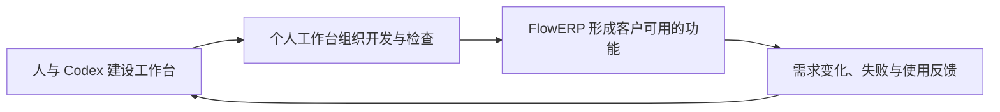
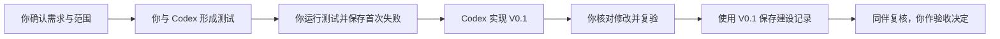
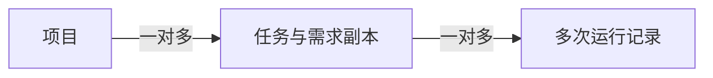
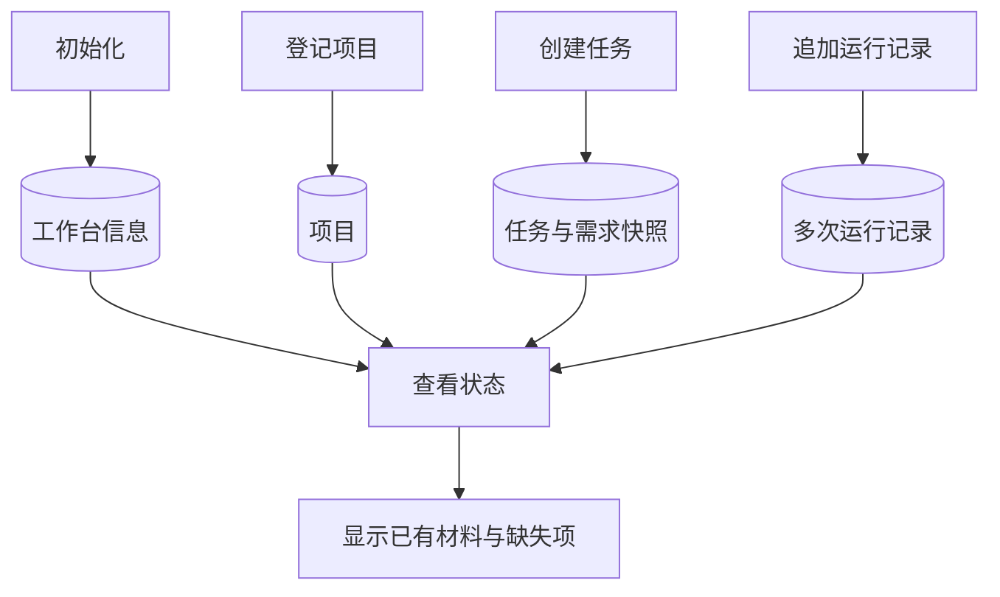

# L01｜以终为始：一次可验证的 AI 交付怎样完成？

本课程首先要交付一套个人研发工作台。我们用 Codex 建设它，再通过它持续开发电商业务系统 FlowERP。工作台积累可复用的研发能力，FlowERP 则用实际需求、失败和交付结果检验这些能力。

这一建设过程从一个问题开始：**当 AI 能够帮助我们写出程序时，还需要怎样的组织方式，才能持续交付符合要求的产品？** 本讲先看课程最终成果，再用“开发一个能保存任务与运行记录的工作台”贯穿讲解和实践。

**本讲主线：代码跑通不等于交付合格 → 需要查清要求、改动与检查依据 → 建设 V0.1 记录层 → 用它记录自身建设，验证设计。**

> **L01 的实际交付：Workbench V0.1 命令行程序。** 你要实现初始化、项目登记、任务创建、运行记录追加和状态查询五个操作。本讲不接入、不开发 FlowERP，也不实现网页、自动调用 Codex 或自动运行验收。第 1 节的成品截图和全课程关系图用于认识最终目标；从第 2 节开始，案例和实验都围绕本讲的 V0.1。

## 本章学习地图

本讲依次讨论四件事：我们最终交付什么；为什么需要工作台；工作台怎样协同 Codex 改善交付质量；第一版应当怎样设计。完成阅读后，你应能解释设计的必要性、指出验证结论的范围，并将一个需求转成可以实际检查的程序行为。

阅读不要求已有软件架构或自动测试经验。相关概念会随问题引入。实践需要完成 [L00 环境准备](../L00-课前准备-安装工具与通过环境自检.md)，能够打开项目、编辑文件并运行给定命令；具体操作见[实践操作手册](./实践操作手册.md)。

除可运行程序外，你还会提交本人确认的需求说明、实现前后的测试记录和设计解释。**L01 的执行组织者是你：你委托 Codex、运行检查，再把结果存进新工作台。** L04 补齐执行与检查能力后，才首次通过工作台交付 FlowERP 库存导出。

## 1. 我们最终要交付什么？——课程成品预览

本节四张截图展示课程参考成品，帮助理解建设方向。L01 的作业是命令行记录工具，后面的页面与业务功能将逐讲建设。

### 1.1 个人研发工作台

与 Codex 开发一个功能时，你需要提供项目背景，说明要解决的问题，判断修改是否合理，并决定结果是否可以交付。任务增加以后，这些工作会反复出现。

**个人研发工作台是组织这类开发活动的程序。** 它把一次任务的要求、执行、检查和决定关联起来，并逐步将重复步骤固定为可执行流程。它的使用者是负责开发与交付的人。


*图 1｜工作台参考成品。项目入口提供开发上下文，任务列表记录正在处理的工作，验收入口集中需要作出决定的结果。*

工作台的核心价值不止在总览页。打开某项任务时，应能查清本次采用了什么要求、做了哪些修改、运行了什么检查，以及哪些问题尚未解决。


*图 2｜参考任务的复验与审核页面。截图中的操作是复验已有任务，当前等待人审；它展示记录的组织方式，不代表这一轮新开发了功能。*

### 1.2 FlowERP：工作台的客户项目

FlowERP 是电商企业使用的业务系统，覆盖商品、库存、订单和采购。ERP 是“企业资源计划”的缩写；在本课程中，重点是这些业务怎样共享数据、彼此影响。


*图 3｜FlowERP 参考成品，使用课程演示账套。企业员工在这里处理业务，开发者在个人工作台中组织这些功能的建设。*

例如，销售人员在 FlowERP 中创建订单，系统为订单预留库存。以后客户要求“取消订单后释放库存”，你在工作台中建立开发任务，请 Codex 协助修改，再用 FlowERP 的实际行为检查结果。


*图 4｜FlowERP 参考库存页面。它展示客户产品将要承接的业务信息；本讲不实现库存页或库存导出。*

因此，两项成果有明确关系：**工作台是首要建设成果，FlowERP 是持续开发而形成的伴生客户产品，也是工作台的验证场。** 产品需求使工具设计有具体用途；产品失败暴露工具能力的不足；改进后的工作台再接受下一次交付检验。

**全课程目标关系图，包含后续能力，不能作为 V0.1 的功能清单。** 图未显示时，可按“人与 Codex 建工作台 → 工作台组织产品交付 → 使用反馈推动下一次改进”阅读。



最终作品是“工作台驱动的电商 ERP 持续交付系统”：一套可以用于其他项目的研发工作台，以及由它逐步组织交付的 FlowERP。工作台是否有效，要回到产品结果判断。例如，原本容易遗漏的库存检查是否稳定执行，需求变更后是否还能找到旧任务采用的规则。

本机已启动参考程序时，可以访问[个人工作台](http://127.0.0.1:8001/)和 [FlowERP](http://127.0.0.1:8000/)。这两个地址指当前电脑，未启动时可以先通过截图理解场景。

> 截图来源：2026-09-05 本地参考程序。图 3 月度销售 ¥39,055.78 表示当月 3 笔未取消订单的金额，包含不同订单状态，不能解释为已收款收入。演示数据与来源见[截图说明](./assets/final-deliverables/README.md)。

## 2. 已经有 Codex，为什么还需要工作台？

### 2.1 从一项开发任务的接手问题开始

你准备让 Codex 开发一个小工具：保存自己的开发任务，并在以后查回每次任务的要求和执行结果。第一次讨论时，需求写在对话里；开始实现后，检查结果出现在终端中；修复一次后，又产生了新的输出。

几天后重新打开项目，你需要回答：当时决定了什么？哪一版实现接受过检查？第一次失败在哪里？如果这些材料没有关联，就要靠记忆重新拼接。

问题不只是材料可能丢失，更在于它们可能还在，却无法说明同一次工作。例如，看到一份成功输出，却不知道它对应修改前还是修改后的程序，就不能据此接受当前版本。

工作台的第一项价值是把这些关系保存下来：项目确定工作归属，任务确定本次目标，运行记录保存每次尝试。V0.1 先提供这层记录能力，后续再把重复执行步骤接入。

### 2.2 运行成功 ≠ 满足需求

现在考虑这项工具的一个具体要求：任务创建后，即使关闭程序，也能再次查询到原内容。

Codex 写出的程序可能成功显示“任务已创建”，却只把任务放在本次运行的内存中。关闭程序再启动，任务就消失了。命令执行到了结尾，但使用者需要的“以后可以查回”没有实现。

**运行成功说明某次操作按程序的路径结束；满足需求还要检查它是否产生了约定结果。** 对业务软件，这就是“运行成功 ≠ 业务正确”；对本讲的工作台，则要检查数据是否真的保存、是否能查回、失败时是否保留原记录。

另一个反例是重复编号。已有任务 A 保存了“开发 V0.1”，再次用 A 创建不同任务，程序显示成功，却覆盖了旧要求。此时功能看似更顺畅，历史记录却被破坏。是否允许覆盖，需要先做设计决定，再检查实现。

### 2.3 哪些重复工作值得固定下来？

记录可以先由文件完成。任务很少、很少交接时，清楚的文件命名与目录可能已经足够。工作台也有建设和维护成本，不能仅以“有界面”或“用了 AI”证明值得投入。

值得优先固化的问题通常反复出现、遗漏后果明确、处理办法相对稳定。例如，每次任务都保存当时的要求；每次运行都关联任务编号；追加新结果时保留旧结果。这些规则可以先写进 V0.1。

而“这次需求是否合理”“剩余风险能否接受”仍依赖具体场景，由人决定。工作台使判断依据容易查到，不会因为保存了材料就自动作出正确判断。

建设后可以观察：接手旧任务花了多久，是否还能找到失败原因，需求变化后是否混用旧结论，以及维护工具花了多少时间。这些观察才能支持对价值的评价。

## 3. 怎样与 Codex 协同，交付本讲的 V0.1？

本节始终使用同一个任务：“创建的任务可以持久保存，重复编号不会覆盖原内容。”先决定要求，再检查实现，最后把建设过程存入工作台。

**下面是 L01 的实际协作流程。委托、运行测试和验收由人组织；V0.1 只在可用后接收记录。箭头表示工作顺序，不表示 V0.1 已自动连接各步骤。**



图未显示时，按“确认要求 → 测试先失败 → 实现 → 同一测试复验 → 导入记录 → 人工决定”阅读即可。

### 3.1 需求说明：先把关键选择说清楚

“保存开发任务”仍有许多待决定的细节：任务属于哪个项目，重复编号怎样处理，程序关闭后数据是否保留。Codex 可以提出问题、比较方案，并整理说明；这些选择应由你根据使用目的确认。

本课程把写清目标、范围和验收条件的需求说明称为 **Spec**。下面是其中一个验收项的节选，完整文档还要覆盖五个操作：

```text
项目：个人研发工作台
目标：创建任务后可以按编号查回要求
约定：任务必须属于已登记项目；关闭程序后仍能读取
重复编号：本版拒绝重复创建，不覆盖原任务
验收：创建任务 A，关闭程序后查询，原要求仍在
反例：再次用 A 提交不同内容，应拒绝，原要求与记录不变
```

这里的重复编号行为是本课选择的设计。它使起步版本容易理解和检查；其他系统也可以采用幂等返回或带版本的更新，只需另行约定并验证。

需求范围确定以后，还要落实到文件。**写集，就是本次允许修改的具体文件集合**；本课程用这个词描述执行范围。例如，实现工作台命令与对应测试，不包含修改 FlowERP 业务代码。发现额外依赖时，先说明原因，再调整范围。

### 3.2 修改对照：解释每项改动的用途

**Diff 是修改前后内容的对照。** 对任务保存功能，核心变化可以这样概括：

```diff
- 任务只保存在当前进程的内存中
+ 任务写入本地存储，重新启动后按编号读取
```

这是设计变化的文字示意，不是可运行代码。阅读实际代码差异时，应找到它对应的写入、读取与错误处理，并检查是否仍在约定文件范围内。

仅看到“增加了数据库代码”，还不能证明保存正确。例如，写入没有提交，程序结束后仍可能丢失。可以请 Codex 解释改动，但解释需要由下一步的实际实验核对。

### 3.3 测试：调用真实操作，再观察保存结果

**测试是一项可重复的实验：建立条件，执行操作，将实际结果与事先确定的预期比较。** 本讲的持久保存实验应跨两次程序运行：

1. 初始化隔离测试目录，登记“个人工作台”项目。
2. 通过创建命令保存任务 A 和它的要求，等待命令结束。
3. 再启动一次查询命令，按 A 读取任务。
4. 核对项目归属和要求与创建时一致。

这组操作可以先手动理解，再写成自动测试。若测试只在内存里构造一份数据，然后检查同一份数据，它没有经过真实保存与重新读取，发现不了目标缺陷。

重复编号实验继续使用任务 A：再次创建不同内容，观察命令是否拒绝，再重新查询 A。**出现错误提示与原数据未被破坏是两项需要分别检查的结果。**

| 实际观察 | 可以得出的判断 |
|---|---|
| 创建成功，重启后找不到 A | 持久保存要求未满足 |
| 重复创建被拒绝，但原要求已改变 | 拒绝响应正确，数据保护仍然错误 |
| 重启后原要求仍在，重复请求未改变记录 | 这些已执行的验收项满足约定 |

其他操作还需要自己的验收项。不要因为一个例子通过就推断五个操作全部正确；也不要忽略已经通过的实验，它们确实为相应行为提供了依据。

### 3.4 先红后绿：验证检查确实触及目标缺陷

先根据 Spec 创建测试，在目标能力尚未实现时运行并保存失败；再请 Codex 实现，用同一输入和预期复验。这个过程称为**先红后绿**：红表示检查失败，绿表示通过。

例如，第一次创建后重启无法查到 A，测试失败；增加持久保存后，同一测试查到原要求，转为通过。这样的前后对照说明，这项检查能够识别并确认目标行为的变化。

起始失败应来自目标能力缺失。Python 无法启动、测试语法错误或实际运行了零个测试，说明实验条件未成立，应先排错并保留记录，不能当成有效的业务反例。

> **在本课的交付标准中，先红后绿是必要条件，不是充分条件。** 它证明同一项检查能发现目标缺陷，并在修复后通过；完整交付还要核对需求、测试覆盖、实际修改、失败后数据与人工复验。这个要求服务于本课的建设过程，不意味着软件工程中的每次变更都必须采用同一种开发顺序。

运行记录应保存命令、输出、时间和退出码。**退出码**是程序结束时返回的数字；0 通常表示该命令按约定成功，非零需要结合输出判断原因。保存一份失败输出的操作可以成功，因为它准确记录了另一条命令的失败。

### 3.5 验收：接受的是有范围的结果

运行检查以后，按五个操作试用自己的程序，并让同伴依据 Spec 复核。例如，自己验证了单次保存，同伴补查重复编号；双方可以明确哪些要求已验证，哪些仍缺依据。

验收可以是接受、退回或依据不足。程序可用但记录缺失时，应说明材料不完整；材料齐全但重复创建仍覆盖数据时，应说明功能缺陷。把两者都写成“通过”会让接手者失去判断依据。

本讲中，Codex 协助形成需求、测试和实现；你组织执行并决定取舍；新工作台保存建设记录。**质量改善来自要求被明确、检查真实执行、问题得到复验，工作台则让这些依据能够关联和查回。** 后续再将执行步骤接入工作台。


## 4. 个人工作台应该怎样设计？

### 4.1 从使用过程推导信息需求

前面的工作台建设过程给出设计起点：选择项目，建立任务，确认要求，实施修改，运行检查，作出验收决定。每一个步骤都需要读取某些信息，也会产生新的信息。

选择项目时，需要知道代码在哪里；创建任务时，需要保存本次目标；执行以后，需要记录实际尝试；验收时，需要将结果与当时的约定对应。功能应从这些需要推导，而不是先列出一组页面或技术名词。

### 4.2 对象为什么分成项目、任务与运行记录？

“个人研发工作台”是一个长期维护的项目；“开发 V0.1”是本次任务；实现前失败与实现后通过，是同一任务的两次运行。以后增加自动执行能力时，应建立另一项任务，保留 V0.1 的建设历史。

**对象关系：一个项目有多项任务，一项任务有多次运行记录。** 即使阅读器不显示图，下面的文本关系也能表达完整含义：

```text
个人研发工作台（项目）
└─ 开发 V0.1（任务，保存当时的需求副本）
   ├─ 实现前测试失败（运行记录）
   └─ 实现后同一测试通过（另一条运行记录）
```



图中的三个对象对应项目、任务和运行记录；每条运行记录归属于一项任务。

分开的依据是变化频率和归属不同。如果只在项目上保存“最近一次通过”，新的运行可能覆盖旧结果，无法解释通过的是哪项需求。将运行记录归到具体任务后，才能追查同一目标经历过哪些尝试。

项目与任务采用稳定编号，也就是 **ID**。名称可以调整，编号仍用于关联原对象。任务还应保存当时需求内容的副本，称为**需求快照**。

例如，创建任务 A 时，Spec 约定“拒绝重复编号”，你据此实现并验收。一周后，新任务提出“相同内容重复提交时返回原结果”，同一个 Spec 文件随之更新。若 A 只保存文件路径，再打开它就会看到新规则，旧实现会被误判为没有遵守当时的要求。

需求快照保存 A 创建时的原文，使旧检查仍能对应旧约定。后续需求可以变化，但不能把变化后的文字当成过去已经采用的依据。快照帮助追溯版本，并不自行提供防篡改或身份认证。

### 4.3 状态不是孤立的“成功”或“失败”

设想需求版本 A 曾经通过检查，后来客户修订为版本 B，而最新检查失败。两个运行结果都是真实的，但含义不同：前者支持旧版本下的判断，后者指出当前尚未解决的问题。

因此，状态必须与任务、需求版本和具体运行关联。历史通过不能自动成为当前保证，新的失败也不应抹去旧记录。一个可解释的状态页，应让使用者知道结果在什么条件下成立。

V0.1 首先实现材料完整性检查：缺少要求的记录时明确报告；记录齐全后等待人工审核。完整性检查说明材料是否能够查到，还不能独自认证材料真实性或证明业务功能已经正确。

### 4.4 正常路径、失败路径与失败后状态

设计一个操作，需要同时规定正常时发生什么、请求不能完成时如何响应，以及已有数据是否保持。最后一项是**失败后状态**，不能仅靠出现错误提示来确认。

例如，已有任务 A 保存了需求和运行记录，又有人使用同一编号创建不同任务。本讲选择拒绝重复编号，并保留原任务。另一种系统可以选择返回原结果，但还需约定两次请求内容不同如何处理。明确拒绝使第一版的行为更容易判断，也减少误覆盖风险。

**下表是本课程为 V0.1 选择的行为约定，不是行业唯一方案。** 更新接口、版本控制和幂等返回也可以是合理设计，需要分别定义条件与失败行为。本次先按同一约定实现和验收，讨论题再比较其他取舍。

| 操作情境 | 预期响应 | 需要再次查询的内容 |
|---|---|---|
| 在已登记项目下创建新任务 | 创建成功 | 任务属于指定项目 |
| 在不存在的项目下创建任务 | 拒绝创建 | 没有留下无所属项目的任务 |
| 使用已有任务编号创建不同任务 | 拒绝覆盖 | 原需求和记录保持不变 |
| 查询材料不完整的任务 | 指出缺少什么 | 已有记录仍然保留 |

这些规则同时确定了测试方法。以重复编号为例，需要先创建，再重复创建，最后重新查询。只检查第二次请求返回错误，仍未验证原数据是否被破坏。

### 4.5 第一版的边界

完整工作台涉及执行、检查、协作和界面。第一课先实现记录基础，因为无论后续怎样执行，都需要知道结果属于哪个项目的哪项任务。

这版程序称为 **V0.1**，提供五个操作：

| 操作 | 形成或读取的信息 | 实践命令 |
|---|---|---|
| 初始化工作台 | 所有者、工作台身份、数据目录 | `workbench-init` |
| 登记项目 | 项目名称与代码位置 | `workbench-project-add` |
| 创建任务 | 项目归属、本次要求及其快照 | `workbench-task-create` |
| 追加运行记录 | 实际命令、输出与结果 | `workbench-evidence-add` |
| 查看状态 | 读取已有材料，指出缺失项 | `workbench-status` |

**V0.1 的交付形式是 Python 命令行程序（CLI，Command-Line Interface）。** 五个名称是 `workbench.cli` 的子命令：学生在终端发出请求，程序处理并输出结果。验收会实际运行命令，仅提供 Python 函数不够；本讲不要求网页或 HTTP 接口。

本仓库使用 Python 标准库 `argparse` 解析命令参数，无需额外安装 Click 或 Typer。实现完成后，可以这样调用状态查询：

```bash
python -X utf8 -m workbench.cli workbench-status
```

前半部分启动工作台的命令行入口，最后的 `workbench-status` 选择查询操作；其余参数和预期输出见实践手册。**持久化**指程序结束后数据仍保留，下次启动可以读取。本课使用本地 SQLite 保存记录，Codex 可以协助实现具体存取代码。

**下图仅展示 V0.1 的数据写入与读取，没有自动调用 Codex 或运行测试的步骤。** 不显示图时，可读作：前四个操作分别保存工作台、项目、任务与运行记录，状态查询读取这些材料并说明缺失项。



V0.1 的代价也很明确：仍由人监督 Codex 开发，运行结果需要保存并导入，工作台尚未自动安排执行。这是按依赖顺序选择的起点。L04 补齐执行与检查能力后，才首次通过工作台交付库存导出。

### 4.6 用第一版检验自己的设计

工作台尚不存在时，由你直接组织开发，先使用课程提供的 [evidence.py 采集工具](./tools/evidence.py)保存运行输出。**这是已经提供的课程脚手架，不属于学员需要开发的 V0.1。** 它负责执行指定命令，保存输出、时间与退出码；不会替你实现项目账和任务账，也不替你判断是否合格。

程序可用后，再登记“个人工作台”项目，建立“开发 V0.1”任务，并通过配套[导入工具](./tools/import_evidence.py)调用自己实现的记录追加命令，导入先前保存的材料。用新工具记录自身建设的过程，本课称为**自举**。

这使第一次使用就能检查设计：任务能否保存需求，失败能否原样导入，记录能否查回。保存一份失败记录可以是成功操作，因为记录系统要如实描述那次失败，而不是只允许保存成功结果。

现在可以形成个人设计：选择两个值得解决的问题，说明它们如何导出数据与操作规则；明确五个操作的范围；为重要规则写出正常与失败实验。按[提交模板](./SUBMISSION.md)保存到 `lesson-01-submission/02-design.md`，再与 Codex 讨论并形成本人签署的 `WORKBENCH_SPEC.md`。

## 5. 实践：建设并验证 V0.1

本节把前面同一条工作台案例落实为实际程序：先确定可检查的要求，再观察缺少能力时的失败，完成实现后复验，并用新程序管理建设记录。

一个完整的验收项可以这样写：

> 已经存在任务 A，保存需求“记录本次建设”。再次用编号 A 提交不同内容时，程序应拒绝请求。随后查询 A，原需求和已有运行记录应保持不变。

这段描述包含前提、操作、响应和失败后状态，可以交给 Codex 转成测试。你需要核对测试是否真正执行了重复创建和后续查询，而不只是检查错误提示。

实践按以下顺序进行，完整命令、预期输出与排错在[实践操作手册](./实践操作手册.md)：

| 阶段 | 实际动作 | 对应设计判断 |
|---|---|---|
| 准备 | 创建隔离练习目录，核对能力起点 | 实际检查的是哪份代码 |
| 设计 | 记录问题与个人方案，确认并签署 Spec | 要解决什么，哪些方案暂缓 |
| 起始检查 | 根据验收项创建测试并运行 | 失败是否来自目标能力缺失 |
| 实现 | 请 Codex 实现，检查并保存 Diff | 改动是否符合要求与范围 |
| 复验 | 运行同一验收测试 | 标准未放宽时，要求是否满足 |
| 使用 | 登记自身项目，导入记录并重新查询 | 记录能否保存、关联与查回 |
| 反证与复核 | 制造缺记录、任务不存在等情境，收集反馈 | 是否如实报告问题并保持原数据 |

参考仓库提供隔离与采集工具，帮助保存输出、时间和退出码。它们是实践支架；你要实现的工作台负责项目、任务和记录的组织。运行数据库与个人材料分别保存，具体位置见[行动卡](./行动卡.md)。

最终提交本人确认的需求、CLI 实现、真实运行记录与设计解释。FlowERP 在 L01 保持原有产品状态；本讲以可运行的 V0.1 验证记录基础。

## 6. 讨论、迁移与复核

以下是开放讨论题，**不需要在讲义中寻找标准答案**。请运用本讲概念自行推理；答案可以不同，需要说明前提、依据与取舍。

1. **建设取舍。** 对每周只有一项开发任务的个人项目，文件管理可能已经足够。什么变化会使建设工作台值得投入？提出可观察的条件，而不是仅以任务数量判断。
2. **检查有效性。** Codex 同时生成实现和测试，所有测试通过。你怎样判断它们是否检查了客户真正关心的结果？给出一项可能被遗漏的情况和核对办法。
3. **状态解释。** 旧需求曾通过检查，新需求下最新运行失败。你会怎样展示两者，使接手者既能理解历史，又能识别当前问题？
4. **迁移。** 用同一工作台组织另一个项目的文档校对。哪些信息与操作可以复用？验收条件怎样变化？哪些检查可程序化，哪些需要编辑判断？

实践前，在提交模板中保存首次判断；实践后，记录判断发生了什么变化以及变化依据。请同伴或教师依据 Spec 复核一个结果，保留反馈和自己的回应。

完成修订后作出**第二次签字**：写明接受、退回或依据不足，并说明范围与剩余问题。尚未获得反馈时标为待复核。评价关注的是从问题到设计、从实验到结论的推理，以及实际实现能否支持它。

## 7. 本课小结

代码跑通以后，仍需说明它为什么满足要求。要让这种判断能够复验，就需要把当时的要求、实际改动、运行结果和人的决定组织起来。本讲为此建设 V0.1 记录层。

项目、任务与运行记录让材料有归属，需求快照保留当时约定，失败记录支持后续修订。用 V0.1 记录自己的建设，实际检验这些设计能否工作，这就是本讲的自举。后续再通过持续开发 FlowERP 检验和扩展工作台能力。

配套：[实践操作手册](./实践操作手册.md)提供执行步骤；[行动卡](./行动卡.md)用于核对顺序；[提交模板](./SUBMISSION.md)保存个人材料；[课堂 PPT](<./slides/L01-以终为始：一次可验证的AI交付怎样完成？-图解版.pptx>)用于图解推演。


## 附录 A：本讲课程大纲合同

【选读参考·提交前核对】

以下保留正式大纲的四项要求，供完成实践后逐项核对。本讲对应课程目标 CLO-1：识别结构、约束、验证入口和责任边界。

- **核心内容**：开课时没有个人工作台、`WORKBENCH_SPEC.md` 或验收测试；学生从一句模糊诉求和真实痛点出发，利用 Codex 完成需求访谈，由学生决定范围并签署首份 Spec，再把验收项转成红灯测试，开发初始化、项目登记、任务账、命令证据账和状态检查。
- **演示结果**：`“帮我搭建个人 AI 研发工作台”` 经历“原始诉求 → Codex 追问 → 学生取舍 → `WORKBENCH_SPEC.md` → 验收测试红灯 → Codex 实现 → 同一测试绿灯”，最后由新工作台记录自己的建设证据。
- **课内增量**：学生亲手形成并签署首份 `WORKBENCH_SPEC.md`、从验收项生成失败测试、开发出可运行的 Workbench V0.1，并完成第一次自举记录；本讲不接入、不开发 FlowERP。
- **通过标准**：Spec 每项关键要求能回指原始痛点、Codex 建议和学生决定；测试能回指验收项；必须保留实现前红灯、范围内 Diff 和实现后绿灯；学生能用自己开发的命令完成自举，并说明 L04 才会通过“个人工作台 + Codex”开发 FlowERP。

## 附录 B：关键词速查

【选读参考·遇到术语时查阅】

| 术语 | 本讲中的意思 |
|---|---|
| Spec | 开发前确认的需求说明，写清做什么、边界和检查办法 |
| Diff | 修改前后的内容对照，用来查看实际改动 |
| ID | 稳定编号，让项目、任务和运行记录能对应起来 |
| 快照 | 当时内容的副本，用来查清当时依据的要求 |
| 红灯／绿灯 | 检查失败／通过，具体原因要查看实际输出 |
| 自举 | 用新工作台记录它自己的建设过程 |
| 持久化 | 程序结束后数据仍保留，下次启动可以读取 |
| 写集 | 本次允许修改的具体文件范围 |
| 命令证据 | 实际运行的命令及输出、时间、退出码等记录 |

## 本讲一手来源

【选读参考·查阅依据】

核验日期：2026-09-05。课程要求来自[课程大纲](../../课程大纲-Codex-FDE行动营-个人研发自动化工作台.md)。命令参数与限制已对照本仓库 [bootstrap 实现](../../../workbench/bootstrap.py)、[隔离快照入口](../../../workbench/course_snapshot.py)和 [L01 参考测试](../../../tests/test_l01_workbench_bootstrap.py)。实现后可用这些位置核对自己的设计；参考测试通过不代表学生达成。

- [OpenAI：非交互模式](https://learn.chatgpt.com/docs/non-interactive-mode)：脚本调用 Codex 的连接方式，支持第 3 节协作说明。
- [Python 3.11：unittest](https://docs.python.org/3.11/library/unittest.html)：测试用例与命令行运行，支持课后验收。
- [Python 3.11：subprocess](https://docs.python.org/3.11/library/subprocess.html)：程序输出和退出状态，供理解后续执行连接时查阅。

示例数据、参考实现、学生个人证据和真实教学效果属于不同层级。学生判断、运行记录与反馈须实际产生，未验证事项如实保留。
