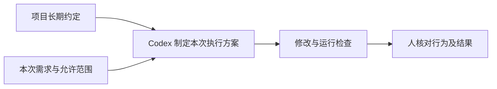

# L02｜把仓库规则写进 `AGENTS.md`

L01 中，我们把一次工作交给 Codex，并用第一版工作台保存任务与执行记录。接下来会出现一个重复的问题：换一个会话之后，仍然需要解释代码放在哪里、哪些数据不能直接修改、完成前要做哪些检查。

如果这些约定只存在于聊天记录里，每次协作都可能从不同的理解开始。本讲把稳定的项目约定写入仓库，让后续任务能够在共同边界内展开。

## 本章学习地图

本讲依次讨论：哪些约定值得长期保存，`AGENTS.md` 怎样影响 Codex，文字规则为什么仍需要程序检查，以及如何验证一条规则既能拦住越界请求，又不妨碍正常开发。

完成后，你将交付一份经过新会话验证的仓库规则。工作台获得可复用的协作约定；FlowERP 的库存、订单与采购要求提供规则依据，本讲不改变它的业务功能或运行数据。

## 1. 从一次不合理的请求出发

考虑这样一个演示请求：“把库存直接改成 100，采购审批以后补，测试暂时跳过。”它包含三个不同问题。数量变化没有对应的入库业务；审批被推迟到操作之后；验证被省略。即使页面能正常显示 100，也不能据此认为系统交付正确。

在当前会话中解释这些问题并不困难。困难在于下一次请求可能换成“临时修正演示数据”，而执行者未必见过上一次讨论。因此，需要把业务依据和可接受的处理方式留在项目内。

一条有用的规则应同时说明禁止的动作与允许的路径。例如，真实采购入库必须经过审批；演示需要额外样本时，可以在与业务库隔离的测试环境中构造数据。后一句很重要，否则“禁止改数据库”会把合法测试和经过审核的数据迁移也一起阻止。


图中是参考系统的审计界面。它帮助追溯已经发生的操作；本讲处理的是操作之前如何给出共同约束。审计记录与仓库规则分别解决这两个时点的问题。

## 2. 什么适合写进 AGENTS.md？

`AGENTS.md` 是放在项目中的 Markdown 文件，内容供 Codex 在工作时参考。适合写入的是跨任务稳定、能够影响具体行动的约定：目录职责、业务限制、检查入口和完成条件。

“这次增加库存导出”属于本次任务。“业务逻辑放在 `flowerp/`，不要把 HTTP 请求处理混入领域服务”则会影响许多任务，适合长期保存。区分依据是约定的有效范围，而不是句子写得是否正式。

下面是一段可用于讨论的规则草案。合并到现有文件时，应保留项目已有约束，并核对命令是否适用于当前环境。

```markdown
## 目录职责
- flowerp/ 保存业务规则；workbench/ 保存研发任务与交付过程。
- eval/ 是统一验收入口，复用已有业务检查。

## 业务约束
- 采购入库必须有审批依据，不直接改运行库来制造成功结果。
- 故障实验使用隔离数据，保留失败记录与修复记录。

## 完成条件
- 运行与变更相关的测试，以及 python -X utf8 -m eval.harness --suite blocking。
- 说明修改范围、验证结果和尚未验证的部分。
```

第一组规则帮助 Codex 找到修改位置；第二组限制业务行为；第三组规定交付时要提供什么。它们都能对应到实际选择。相比之下，“保持高质量”“遵守最佳实践”很难直接判断是否做到。

规则也有维护成本。过时的检查命令会让每次任务都失败；相互冲突的描述会迫使执行者猜测。新增规则之前，先问它是否来自反复出现的问题，是否已有更合适的程序校验负责。

## 3. 它怎样进入一次协作？

按 Codex 官方说明，项目指令在启动时按目录层级组合；靠近当前工作目录的指令可以细化或覆盖较早的指令。全局文件、项目文件和覆盖文件的发现顺序有明确规则，不能仅凭“文件在仓库里”就推断已经生效。[官方发现规则](https://learn.chatgpt.com/docs/agent-configuration/agents-md)



这里有两个层次。工具机制决定哪些指令进入上下文；项目治理决定哪些约定可以被修改。本课程要求库存与审批等业务规则不能被子目录随意取消，这是项目约定，不应误写成“工具从技术上不允许覆盖”。

修改规则以后，用新会话验证，并记录启动目录、规则文件版本和 Codex 实际提出的行动。让它复述文件只证明可以找到文字；观察它处理一个具体任务，才能了解规则是否影响了行为。

## 4. 文字规则与程序约束怎样分工？

`AGENTS.md` 是指令，不是操作系统权限。它能指导 Codex，但不会在数据库层自动阻止越权入库。业务服务仍要检查审批状态，执行环境仍要限制实际可访问的资源，测试仍要检查规则是否被实现。

下面几个常见名词可以按“在协作中负责什么”区分。当前只需要理解分工，后续需要时再实现。

| 机制 | 在本课程中的用途 | 例子 |
|---|---|---|
| Prompt，本次指令 | 描述这一次要完成的工作 | 增加只读库存导出 |
| AGENTS.md | 保存稳定的项目约定 | 不绕过采购审批 |
| Skill，可复用工作方法 | 保存某类任务的步骤与资源 | 按固定方式审查交付材料 |
| Hook，事件触发程序 | 在指定时点运行检查 | Codex 准备结束时运行验收 |
| MCP，工具连接协议 | 让模型调用外部能力 | 访问已授权的需求系统 |

这些机制不必同时使用。当前仓库已有文件和命令可用，就不需要为了“自动化”额外引入外部服务。选择依据是缺少哪项能力。

## 5. 实践：验证规则能拒绝，也能放行

先在隔离练习目录保留规则修改前的版本。请 Codex 针对第 1 节的请求只给出方案，不执行数据修改。记录它是否注意到审批、数据来源和验证要求。这是对照观察，不需要真的制造业务损失。

接着补充最少的规则，并启动新会话。再次提出同一请求，检查回复是否指出具体冲突，并给出隔离演示数据或正常审批入库的替代方案。一次正确拒绝是本次实验结果，不能保证以后所有措辞都被正确处理。

然后走一条**正常路径**：“请在隔离测试数据中补充一个库存样例，并运行现有检查。”规则应允许这类工作。检查修改位置、测试结果，以及真实业务库没有被当作实验输入。

对照中的越界请求是**失败路径**。合理的**失败后状态**是业务数据没有被修改，原请求和拒绝依据仍可查阅，而不是删掉请求后只展示正常结果。

激活项目虚拟环境后，在练习仓库根目录运行：

```bash
python -X utf8 -m eval.harness --suite blocking
```

这条命令检查已有阻断用例。退出码为 0 只说明这些用例通过，不能单独证明新会话加载了规则，也不能替代对运行数据的检查。把规则行为观察和程序检查结果分别写清，结论才有依据。

提交时保留规则前后差异、两类请求与响应、实际检查结果。请另一位同学进行**第二次签字**：用不同措辞复验一条边界，并写出仍存在的歧义。迁移练习是为另一个目录写一条具体约定，说明为什么放在那里，以及它如何与根目录规则兼容。

## 6. 小结：让协作从共同约定开始

工作台保存的不只是任务结果，还包括执行任务时应继承的规则。好规则来自明确的问题，给出可观察的行动要求，并与业务校验和实际权限配合。

下一讲将处理另一种信息：每次任务都会变化的需求。长期规则确定边界，Spec 则把这次需求变成可检查的交付约定。

## 配套实践与阅读

[行动卡](./tasks/L02-AGENTS项目约束.md) · [实践提示词](./labs/L02/prompts/README.md) · [提交模板](./labs/L02/SUBMISSION.md) · [课堂 PPT](<./slides/L02-把仓库规则写进AGENTS.md.pptx>)

## 附录 A：本讲课程大纲合同

以下保留课程大纲的四项约定，供完成学习后核对。

- **核心内容**：Prompt、`AGENTS.md`、Skill、Hook、MCP 的职责边界；最小而有效的项目约束。
- **演示结果**：同一任务在缺少约束与加入约束后产生不同结果。
- **课内增量**：补齐目录结构、禁止事项、验证命令和 Definition of Done。
- **通过标准**：新会话能够读取约束；错误命令或越界修改能被明确拒绝或纠正。

## 本讲一手来源

> 核验日期：2026-09-04。来源用于解释机制，不改写课表主题、课程大纲合同或 FlowERP 通过标准。

- [OpenAI：AGENTS.md](https://learn.chatgpt.com/docs/agent-configuration/agents-md)
- [OpenAI：Hooks](https://learn.chatgpt.com/docs/hooks)
- [OpenAI：MCP](https://learn.chatgpt.com/docs/extend/mcp)
