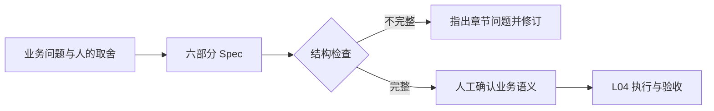

# L03｜把模糊需求变成可验收 Spec

“导出一份库存表”听起来已经足够明确。真正实现时，开发者却仍要决定导出在库量还是可用量、哪些列需要出现、没有数据时怎么办，以及导出是否允许改变库存。

这些决定会直接影响结果是否可用。把它们留给 Codex 猜测，只是把需求讨论推迟到代码完成之后。本讲学习在实现之前，把关键选择写成一份可验收的 Spec。

## 本章学习地图

我们从库存导出推导一份需求说明，再区分业务上说清楚与程序上能识别，最后开发最小解析器并验证它的拒绝行为。

你将交付经过确认的库存导出 Spec，以及工作台读取 Spec 的能力。本讲仍由学生直接监督 Codex 开发工作台；FlowERP 的导出功能在 L04 实现。这里的业务案例为那次实现提供依据。

## 1. 先确定使用者拿这份表做什么

假设运营需要知道哪些商品还能接受订单。某商品在库 8 件，已有订单预占 3 件。若导出 8，文件完全可能生成成功，但运营会高估还能销售的数量。按当前业务口径，可用量应为 8 − 3 = 5。

这一步先确认目的与口径，暂时不讨论函数名。Codex 可以帮助列出待确认问题：是否分仓位展示，是否包含零库存，是否需要批次号。对这些问题的取舍仍来自使用场景，由需求负责人确认。

需求不必一次穷尽所有未来情况，但必须覆盖本次结果是否可用的关键条件。例如，本次先不做自动补货和定时邮件，这是范围选择；CSV 中的逗号是否被正确处理，则直接影响文件能否读取，不宜推迟。

## 2. Spec 的作用是连接需求与检查

Spec 是 specification 的简称，本课程用它指一份结构化的需求约定。它至少让实现者和复验者能够回答同一组问题：为什么做、做到什么、哪些不做、遵守什么、如何检查、何时完成。

下面是一份完整的最小示例，可保存为练习文件。示例中的确认项需要由实际需求负责人审核后填写。

```markdown
## 来源
运营需要按商品核对可售数量；需求确认人和确认日期见本次提交记录。
## 目标
导出可读取的库存 CSV，供运营核对当前库存。
## 非目标
不自动补货，不发送邮件，不提供写入或调整库存的接口。
## 约束
只读库存；available = on_hand - reserved；按 sku 升序输出。
## 验收用例
列依次为 sku,name,site,location,lot_id,on_hand,reserved,available。
在库 8、预占 3 时，可用量为 5。
空库存仍输出表头；中文、逗号、引号及换行按 CSV 规则处理。
导出前后库存与业务流水不变；失败不能留下可被误用的部分结果。
## 完成定义
上述验收项通过，检查修改范围，记录确认人、验证结果和已知限制。
```

六个标题分别承担不同职责。“来源”解释要求从何而来；“目标”描述用途；“非目标”限制规模；“约束”限制实现；“验收用例”给出可观察结果；“完成定义”约定交付手续。

可用量为 5 是一个具体样例，公式则是适用于其他数量的规则。两者都需要：只有公式容易忽略实际检查，只有一个数字又可能得到针对样例写死的实现。复验时应再换一组数量。


图中展示了参考系统承接需求说明的方式。阅读重点是需求如何成为一份可审查的对象；当前作业先完成文档与解析能力，界面本身不构成需求正确的证明。

## 3. 从文档到工作台可以处理的输入

如果后续程序需要自动找到“验收用例”，就不能完全依赖作者自由排版。工作台需要一个解析器：读取文本，识别章节，再把内容交给执行环节。

仓库的 `workbench/spec.py` 规定六个章节必须按顺序出现。它检查缺少章节、重复章节、未知章节、空内容及未闭合代码块；遇到这些问题直接报告错误，不继续执行需求。



这里必须区分两种正确。把“可用库存等于在库量”写进完整的六个章节，解析器仍可能接受；它只能判断结构符合约定，无法自行确定库存口径是否正确。结构检查降低自动处理的歧义，业务确认决定要求是否值得实现。

同样，程序能够找到“验收用例”并不意味着已经把自然语言全部转换成可靠测试。测试需要调用真实功能、构造输入、读取实际输出，再与预期比较，这将在后续逐步建立。

## 4. 实践：用一个缺失章节检验解析器

在隔离练习工作区保存上述示例，激活虚拟环境后运行：

```bash
python -X utf8 -m workbench.cli spec FDE_SPEC.md
```

`spec` 是读取并校验文件的操作，后面的文件名是输入。**正常路径**下，命令展示解析后的字段并正常结束。应核对字段内容与原文一致，尤其不能把代码块里的标题误认为真实章节。

接着复制一份练习文件，去掉“非目标”章节，再运行同一命令。这条**失败路径**应指出结构问题并以非零退出码结束。具体错误文字可能随实现变化，关键是能定位原因，且没有把残缺输入当成可执行任务。

合理的**失败后状态**是原文件保留、错误可查看、后续执行未启动。修复应发生在输入或解析逻辑中，不能通过关闭检查让文件勉强通过。

先写出缺失章节应被拒绝的测试，让它在未实现解析规则时失败；再请 Codex 在允许范围内补齐解析器，并运行同一测试。还应覆盖完整文件、重复章节、空章节与代码块中的示例标题。这些输入分别检验接受能力与拒绝能力。

最后运行本讲已有检查：

```bash
python -X utf8 -m eval.harness --suite blocking --case spec_contract_rejects_ambiguity
```

这个名称指向仓库中的一个验收用例，不是自然语言需求理解服务。阅读报告时，要说明它实际检查的范围，避免把“结构检查通过”扩大成“需求没有歧义”。

## 5. 为什么增加说明有时仍然无效？

问题通常不在字数不足，而在没有做决定。“输出合理的库存数据”仍把合理的含义留给实现者；“完善所有异常情况”没有说明异常发生后哪些状态必须保持。

更有效的写法是描述输入、预期结果及不可改变的状态。对于只读导出，除了文件内容正确，还要检查库存和流水没有变化。对于空数据，应明确是表头、空文件还是错误；不同选择都可能合理，但只能依据使用需要作出同一个约定。

审查 Spec 时，可以让 Codex 提出反例，由人判断它是否属于本次范围。不要把所有建议都纳入第一版，否则 Spec 会从消除关键歧义变成不断扩大项目。

## 6. 复验与迁移

提交原始诉求、问题清单、你的取舍、签署后的 Spec、解析器差异与前后测试结果。**第二次签字**由同伴选择一项验收要求，说明可以如何独立检查，并指出一项仍需业务确认的条件。

迁移练习可以换成“导出未完成采购申请”。沿用六部分结构，但重新判断字段、状态、排序、权限与空数据行为，不直接把“库存”替换成“采购”就结束。

本讲建立了一个连接：需求的关键选择进入 Spec，Spec 的结构成为工作台可检查的输入。下一讲将把这份输入交给 Codex，第一次通过工作台完成 FlowERP 的真实增量。

## 配套实践与阅读

[行动卡](./tasks/L03-Spec驱动.md) · [实践提示词](./labs/L03/prompts/README.md) · [提交模板](./labs/L03/SUBMISSION.md) · [课堂 PPT](<./slides/L03-把模糊需求变成可验收Spec.pptx>)

## 附录 A：本讲课程大纲合同

以下保留课程大纲的四项约定，供完成学习后核对。本讲对应 CLO-2：可验收需求与受控实现。

- **核心内容**：目标与非目标、正常与错误路径、边界条件、可执行验收项、最小变更原则。
- **演示结果**：把“增加导出功能”拆成结构化 `FDE_SPEC.md`。
- **课内增量**：由学生在外循环直接监督 Codex 实现 Spec 模板与最小解析器，只生成和校验合同结构，不执行 FlowERP 业务编码。
- **通过标准**：Spec 至少包含目标、非目标、约束、验收用例和来源；缺失必要字段时返回明确错误。

## 本讲一手来源

> 核验日期：2026-09-04。来源用于解释机制，不改写课表主题、课程大纲合同或 FlowERP 通过标准。

- [OpenAI：Evaluation best practices](https://developers.openai.com/api/docs/guides/evaluation-best-practices)
- [HBS：Case Method Teaching](https://www.hbs.edu/case-method-project/about/Pages/case-method-teaching.aspx)
- [Cornell：Problem-Based Learning](https://teaching.cornell.edu/teaching-resources/active-collaborative-learning/problem-based-learning)
