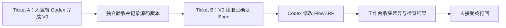

# L04｜委托 Codex 执行一次最小变更

前三讲已经形成任务记录、仓库规则和可验收的需求说明。本讲把这些能力连接起来：先验收能够组织一次执行的工作台 V0，再让它承接库存导出需求，调用 Codex 修改 FlowERP，并汇总结果。

这是课程第一次通过工作台交付客户产品。核心问题随之改变：除了代码是否正确，我们还要知道，这次执行读了哪份要求、修改了哪个版本、检查的是不是同一份结果。

## 本章学习地图

阅读顺序是：为什么需要两次交付，如何限定一次执行，如何解释 Diff 与退出码，以及怎样分别验收工作台和库存导出。

完成后，工作台 V0 能组织一次受控执行；FlowERP 新增只读库存 CSV 导出。学生确定边界和验收依据，Codex 负责实现，工作台负责组织与记录，复验者对交付结果作独立判断。

## 1. 为什么不能直接让工作台宣布自己可用？

假设工作台的检查程序始终输出“通过”。它可以给自身实现写出一份漂亮的成功报告，却没有提供可信的检查。这是把待验证的能力当成了验证自己的前提。

因此，本讲拆成两张任务单。**Ticket A** 由学生直接监督 Codex 补齐工作台 V0，并请独立复验者验收。**Ticket B** 才使用验收后的 V0 承接库存导出，组织人与 Codex 协作。这个从“人直接组织开发工作台”到“通过工作台组织客户项目交付”的变化，称为本课的**自举换挡**。



两张任务单可以发生在同一仓库，但不能省略中间的独立验收。工作台通过验收后又被修改，先前的结论就不再自动适用于新版本，需要重新确认。

## 2. 把“请执行”变成一次有边界的委托

Codex 执行前至少需要四类输入：本次 Spec、项目规则、允许修改的范围、验证命令。工作台还应确定运行目录和超时，避免同一命令在错误目录或无限等待中失去意义。

**写集**指本次允许修改的文件集合。例如，导出需求可能需要修改业务导出实现与对应测试；不能顺便更改采购审批或删除无关验收。具体文件列表应从当前代码结构推导，再由人确认，不能把整个仓库作为默认范围。

**快照**是执行前某一版本的记录，用来与执行后比较。在本课程中，它服务于两个问题：开始时是什么状态，最终改动了什么。快照本身不保证数据隔离，也不代表已备份所有运行环境。

**Diff** 是两个版本的差异。检查时先看文件范围，再看行为变化。仅仅代码行数少，不代表风险小；删除一个审批判断，可能比新增几十行格式处理更重要。


这是参考系统的执行展示，用来观察需求、执行和证据如何关联。截图所在界面不能替代本次工作台 V0 的独立验收；作业以自己的两张任务单和实际运行结果为准。

## 3. 以库存导出为例检查交付

L03 已约定 CSV 的八个字段、可用量公式、排序、空数据与只读行为。现在把这些要求转成检查：构造在库 8、预占 3 的商品，调用真实导出函数，读取生成文件，核对可用量为 5。

再换一组数量，并加入名称包含逗号的商品。这样既检查业务口径，也检查文件是否仍能按列读取。只搜索文件里有没有字符“5”，无法证明它位于正确的商品与列中。

只读要求需要另外观察。保存导出前的库存与相关流水，导出后再比较；不能因为导出函数名称含有“只读”，就省略这项检查。写文件失败时，还应确认没有留下会被当成完整交付的部分文件。

于是，一次成功至少包含三种结论：执行程序正常结束；指定验收项通过；人认为本次范围内的结果可接受。这三种结论相关，但不能相互替代。

## 4. 怎样理解退出码与执行记录？

退出码是进程结束时交给调用者的数字，通常 0 表示该命令按约定成功，非零表示失败。Codex 进程返回 0，不等于库存公式正确；检查程序返回 0，也只覆盖它实际运行的用例。

工作台应分别保存执行器与验收程序的命令、目录、输出和退出码。否则，一个程序的成功很容易被误用为整次交付成功。报告还要绑定任务与源码版本，避免拿上次的绿灯说明本次修改。

独立复验的价值在于重新运行和交叉核对。退出码、时间戳与文件哈希并不是“无法伪造”的证明。最终 Diff 也无法展示所有中间动作；若需要限制执行时的文件访问，应使用实际权限与隔离机制。

## 5. 实践：先验收 V0，再交付导出

在准备好的隔离工作区中完成 Ticket A。先让未具备执行能力的 V0 在相关测试中失败，再委托 Codex 实现最小连接。激活项目虚拟环境后运行：

```bash
python -X utf8 -m unittest tests.test_workbench -v
```

除了正常读取 Spec 和保存结果，还要尝试不存在的输入、执行超时与命令失败。工作台应保留原因，不能产生已经接受的交付状态。随后按[独立验收衔接说明](../reference/L04工作台独立验收衔接.md)记录审核人、任务编号与被验收的源码版本。

Ticket B 使用这份已接受的 V0。课后操作入口会要求引用 Ticket A 的真实编号。把 L03 签署的导出 Spec 交给工作台，保留实现前失败、Codex 修改与实现后检查：

```bash
python -X utf8 -m unittest tests.test_flowerp -v
python -X utf8 -m eval.harness --suite blocking
```

第一条检查 FlowERP 的相关行为，第二条检查统一阻断用例。两者输出都应留存；后面的命令通过不能覆盖前面失败的事实。当前参考仓库已经实现功能时，应按行动卡生成缺少本讲增量的隔离工作区，不能把终态仓库的现成绿灯作为自己的构造过程。

**正常路径**是：V0 独立验收通过，导出实现符合 Spec，检查通过，人接受结果。**失败路径**可选择在 Ticket A 验收后修改 V0 源码，再尝试启动 Ticket B。预期应要求重新验收，而不是继续沿用旧结论。

另一条失败实验是导出数量错误。此时的**失败后状态**应是任务待修订、错误报告保留，库存不被导出操作改变。修复后仍运行原检查，另存新结果。

## 6. 复验与小结

提交材料要让读者从 Ticket B 找回所使用的 Ticket A、Spec、源码差异和验收结果。**第二次签字**由独立复验者完成，说明验收的是哪个版本、哪些要求，以及尚未覆盖的情况。

迁移练习是设计“导出采购申请”的最小委托：哪些工作台能力可以直接复用，哪些业务口径必须重新确认？如果还要重新设计整套执行记录，说明可复用能力尚未真正形成。

本讲完成的是从记录工具到交付工作台的连接。下一讲将进一步研究验收本身：怎样设计一个检查，使它确实能识别错误，而不是只陪伴正确代码运行。

## 配套实践与阅读

[行动卡](./tasks/L04-Codex最小变更.md) · [实践提示词](./labs/L04/prompts/README.md) · [提交模板](./labs/L04/SUBMISSION.md) · [课堂 PPT](<./slides/L04-委托Codex执行一次最小变更.pptx>)

## 附录 A：本讲课程大纲合同

以下保留课程大纲的四项约定，供完成学习后核对。本讲对应 CLO-2：可验收需求与受控实现。

- **核心内容**：非交互执行、工作目录、权限边界、结果采集与人工确认点。
- **演示结果**：读取第 3 讲 Spec，委托 Codex 完成一个小型代码变更并运行测试。
- **课内增量**：先由学生直接监督 Codex 补齐并独立验收 Workbench V0 的执行入口、写集检查、最小 Eval 和结果摘要，再由 V0 在授权工作区调用 Codex 交付库存导出；不额外包装为文件读写 MCP。
- **通过标准**：变更能够运行；基础测试通过；摘要包含修改文件、验证命令和剩余风险；密钥和环境文件未提交。

## 本讲一手来源

> 核验日期：2026-09-04。来源用于解释机制，不改写课表主题、课程大纲合同或 FlowERP 通过标准。

- [OpenAI：Codex non-interactive mode](https://learn.chatgpt.com/docs/non-interactive-mode)
- [OpenAI：Permissions](https://learn.chatgpt.com/docs/permissions)
- [Google SRE：Release Engineering](https://sre.google/sre-book/release-engineering/)


### 起始失败要落到产品能力

若起始检查只提示课程能力未启用，先由工作台核对隔离准备，不要让Codex越界修改课程门槛。历史基线的库存导出可能位于通用导出服务，不能只按新版文件位置判断。去掉课程辅助门槛后若检查已经通过，仍不能作为本次实现起点；应准备实际缺少库存导出能力的隔离副本。实现后还要打开导出文件，核对现存、预占和可用数量；单个红绿结果不替代本讲两张Ticket及独立验收要求。

### 将已接受的工作台交给下一张任务

库存导出执行前，填写已由同伴独立复验和接受的工作台任务编号。系统核对职责记录，并在两张任务中互相留下引用；同伴的签收不会让库存导出自动通过。参见[独立验收衔接操作](../reference/L04工作台独立验收衔接.md)。教师还须核对工作台原始 Diff、失败证据和学生解释，不能把署名字段当成独立完成的证明。

### 追加反证：已验收的代码被改过

在隔离练习中，对工作台验收覆盖的源码作一次小修改，再尝试沿用旧 Ticket A。预期在签收或 L04 启动前被拒绝，不启动 Codex。提交首次判断、修改文件、拒绝结果和重新独立复验后的修订说明。源码指纹随报告保存，范围与操作见[验收衔接说明](../reference/L04工作台独立验收衔接.md)。它核对磁盘源码，不证明人员身份或冻结运行环境。
