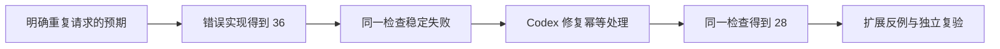

# L05｜先设计失败，再编写 Eval

库存导出已经说明，代码正常结束与业务结果正确是两件事。本讲把注意力转向检查本身：如果从未见过一个测试发现错误，我们凭什么相信它能保护后续交付？

我们用重复入库这个真实业务问题设计 Eval。Eval 在本课程中指用来判断交付是否满足要求的可执行检查；它可以使用测试框架，也可以由独立程序实现。

## 本章学习地图

先从重复请求推导幂等规则，再构造能暴露缺陷的检查，最后把业务检查与工程约束检查接入工作台。

本讲的 FlowERP 增量是幂等入库；工作台增量是能够稳定发现缺陷的验收用例。人确认业务预期，Codex 协助构造测试和修复，工作台保存同一检查在修复前后的结果。

## 1. 同一请求为什么会出现两次？

操作员提交“入库 8 件”后，页面迟迟没有响应，于是再次点击。也可能第一次请求已经执行，只是响应在网络中丢失。服务端看到两次请求，并不代表仓库实际收到了两批货。

假设原来有 20 件。第一次入库后应为 28，重复提交同一笔入库仍应为 28；只有第二笔独立入库才应增加到 36。识别依据是业务操作的身份，不能简单规定“数量相同就不再入库”。

**幂等**在这里指同一业务请求重复执行，对业务状态产生与执行一次相同的效果。**幂等键**是这笔请求的标识。它应随重试保持不变，新业务操作才使用新标识。

| 操作 | 业务身份 | 预期库存 |
|---|---|---:|
| 初始状态 | 尚未入库 | 20 |
| 入库 8 件 | 同一笔收货 A | 28 |
| 重试入库 8 件 | 仍是收货 A | 28 |
| 另一笔入库 8 件 | 新收货 B | 36 |

## 2. 从业务预期推导检查步骤

检查需要自行建立独立数据，调用真实入库服务，再读取真实库存与流水。不能把期望数字写进结果对象，然后检查它等于自己。

下面是检查设计，而非可执行接口代码。它明确每一步要观察什么，具体服务调用以仓库实现为准。

```text
建立独立测试库，商品库存为 20
调用入库服务：请求 A，数量 8
读取库存与流水：库存为 28，新增一次入库记录
再次调用入库服务：请求 A，数量仍为 8
再次读取：库存仍为 28，未新增第二次入库记录
```

为什么同时检查库存和流水？一个实现可能错误地写了两条流水，却又把库存改回 28。只检查最终数量会漏掉这类不一致。验收观察应覆盖对业务有意义的状态，而不只看一条返回消息。

还需要两个反例。同一个键改成不同数量时，应按已确认约定报告冲突，不能悄悄解释为新业务；数量非法的请求失败后，不应留下已成功处理的记录，妨碍后续合法处理。

## 3. 先设计失败有什么作用？

在隔离工作区中，暂时使用每次都增加库存的错误实现。上述检查应得到 36，并因预期 28 而失败。再运行一次，仍应在同一业务条件上失败。这排除了测试依赖上次残留数据或偶然时序的部分风险。

然后修复实现，并用原检查得到通过。这就是“先红后绿”：红表示检查发现目标缺陷，绿表示修复后的行为满足相同要求。不是所有红灯都有效——模块未安装、路径错误或测试根本没有运行，都没有证明幂等缺陷被识别。



先红后绿提供一个有用的因果对照，但不是测试完备性的证明。它说明检查能发现这个已知错误，仍可能遗漏并发请求、事务中断或其他未构造的输入。

## 4. 实现需要保证哪些操作一起发生？

识别请求、更新库存与记录入库结果属于同一业务操作。如果先记录请求成功，再更新库存，程序中途失败会留下“处理过但未入库”；反过来，则可能留下“已入库但重试无法识别”。

这些改变需要作为一个事务提交。事务在这里的作用是让一组数据库改动一起生效，或在失败时一起撤销。数据库唯一约束还可以帮助防止同一业务身份出现多条成功记录。具体方案需要结合现有服务与数据表设计，不能只在页面上禁用重复点击。

业务预期由人确定，Codex 可以提出实现方式和反例。复验时重点检查状态是否一致，而不是要求它必须采用某一种代码写法。

## 5. 业务 Eval 与工程 Eval

幂等入库检查回答“业务是否正确”。本讲还要补充工程约束检查，例如是否误提交密钥。它回答“交付过程是否违反项目要求”。两者都可能阻断交付，但观察对象不同。

密钥检查实验只能使用明确无效的测试字符串，放在隔离测试输入中。不要为验证扫描器制造真实凭据泄露。检查还应考虑合法占位符，避免为了提高检出率把所有配置文本都判成秘密。


图中的阻断结果表示某项检查未满足约定。阅读时应继续追溯到具体输入、观察值和原因；颜色本身不能说明测试是否合理。

## 6. 实践与复验

在本讲隔离工作区中，先新增或检查幂等用例，确认它调用真实入库服务，并为每次运行建立独立数据。激活虚拟环境后运行：

```bash
python -X utf8 -m eval.harness --suite blocking --case receiving_is_idempotent
python -X utf8 -m eval.harness --suite blocking --case no_committed_secrets
```

第一条选择入库业务检查，第二条选择工程约束检查。预期报告分别列出所选用例；失败返回非零退出码。记录每条命令的结果，不能只保存最后一条。

**正常路径**覆盖第一次入库、相同请求重试以及新请求。**失败路径**覆盖同键不同内容与非法数量。每个失败用例都要描述**失败后状态**：库存、流水与请求记录哪些不变，哪些错误信息被保留。

请 Codex 在约定范围内修复，再复跑同一组检查与已有阻断套件。提交两次可复现红灯、修复差异、绿灯和观察到的数据库状态。**第二次签字**由同伴更换数量或请求顺序复验，说明是否仍满足规则。

迁移练习：支付回调重复到达时，哪些对象对应本讲的请求身份、库存与流水？思考重点是一次业务效果如何被识别和保存，而非复制函数名称。

下一讲把这些分散检查组织成统一 Harness，使本地、Hooks 和 CI 能够依据同一套结果作决定。

## 配套实践与阅读

[行动卡](./tasks/L05-失败优先Eval.md) · [实践提示词](./labs/L05/prompts/README.md) · [提交模板](./labs/L05/SUBMISSION.md) · [课堂 PPT](<./slides/L05-先设计失败，再编写Eval.pptx>)

## 附录 A：本讲课程大纲合同

以下保留课程大纲的四项约定，供完成学习后核对。

- **核心内容**：示例测试与 Eval 的区别；逻辑错误、边界缺失、规范违规和危险修改四类失败模式。
- **演示结果**：一个故意带缺陷的基线稳定触发失败。
- **课内增量**：编写一个业务结果 Eval 和一个工程约束 Eval。
- **通过标准**：缺陷基线连续运行两次均失败；失败信息能够定位到具体要求。

## 本讲一手来源

> 核验日期：2026-09-04。来源用于解释机制，不改写课表主题、课程大纲合同或 FlowERP 通过标准。

- [OpenAI：Evaluation best practices](https://developers.openai.com/api/docs/guides/evaluation-best-practices)
- [Google SRE：Monitoring Distributed Systems](https://sre.google/sre-book/monitoring-distributed-systems/)
