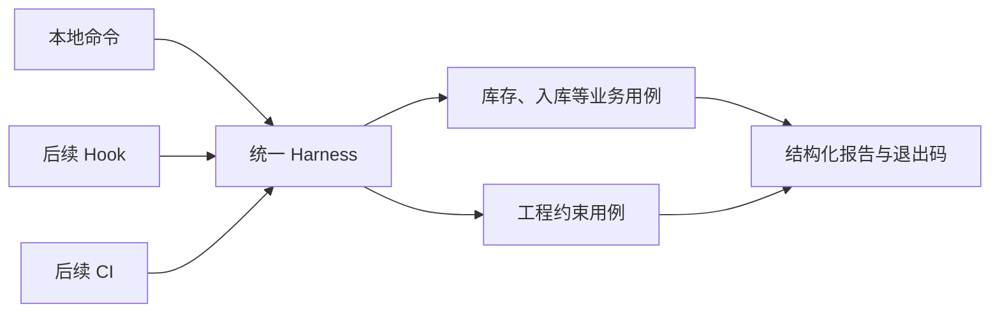

# L06｜用 Harness 汇总证据和等级

检查数量增加以后，一个新的问题出现了：导出测试通过，入库检查失败，文档检查发出警告，这次交付到底能否继续？如果每个入口各自解释结果，本地与自动化流程就可能得出不同结论。

本讲建设统一的 Harness。这里的 Harness 是组织检查执行、汇总结果并给出约定结论的程序。它不替代业务测试，而是让这些测试能够被稳定调用和解释。

## 本章学习地图

我们通过统一可用库存口径，理解用例、执行器和交付结论的分工，再设计结果结构、等级与退出码，最后验证执行器自己的失败行为。

FlowERP 本讲统一可用库存的计算口径；工作台新增统一报告与等级汇总能力。Codex 协助梳理重复计算与实现执行器，人确定哪些失败应阻断，复验者核对报告和实际执行是否一致。

## 1. 为什么要先统一库存口径？

假设库存页面用“在库量减预占量”，导出却直接使用在库量。两个功能都能运行，分别写的测试甚至可能都通过，因为各自使用了不同的预期。

对于在库 8、预占 3 的商品，本课程约定可用量为 5。页面、导出和订单判断应依据同一业务规则。集中计算可以减少重复实现；跨入口检查则验证调用者确实使用了这套规则。只做其中一种，仍可能留下绕过路径。

这也说明，统一 Harness 不能自动统一业务含义。必须先确认预期，再由 Harness 运行检查。一个执行器可以非常可靠地运行一组错误测试。

## 2. 用例负责观察，Harness 负责组织

一个用例负责建立输入、调用功能、比较实际与预期。Harness 负责选择哪些用例、依次运行、记录耗时、捕获异常并汇总。让同一套用例服务多个入口，可以减少“本地检查一种，CI 检查另一种”的偏差。



仓库实现位于 `eval/harness.py`。每个用例登记名称、等级和执行函数。名称让调用者能精确选择检查；等级表达失败的影响；函数实施具体观察。

用例抛出异常时，Harness 保存异常类型与原因，并把该用例记为失败。异常可能来自业务断言，也可能来自测试环境故障，报告需要保留这种区别，不能把所有情况都描述成同一个业务错误。

## 3. 为什么需要等级？

库存不能为负、采购需要审批等要求，失败时不应继续接受交付，属于 `blocking`，即阻断级。某些资料完整性观察可以标为 `observing`，即观察级：需要呈现问题，但不一定阻断当前业务交付。

等级由需求风险与课程约定确定。不能因为一个检查经常失败，就临时把它降为观察级。若确实需要变更，应说明业务依据，并把等级变化作为独立决策审查。

本仓库的汇总规则是：只要存在阻断失败，结论为 `block`；否则为 `pass`。观察失败仍计入报告。因而 `pass` 并不等于每一项都通过，阅读时还要看观察失败数量。

## 4. 报告为什么要同时给人和程序使用？

人需要知道哪里失败、如何复现；自动化入口需要稳定判断是否继续。单纯输出一段解释文字很难被程序可靠读取，所以 Harness 同时保存 JSON——一种用字段和值表达结构化数据的文本格式。

以下为报告字段节选，说明一次单用例运行的形状，数值仅作格式示例：

```json
{
  "suite": "blocking",
  "summary": {
    "total": 1,
    "passed": 0,
    "blocking_failed": 1,
    "observing_failed": 0,
    "decision": "block"
  }
}
```

`total` 是实际运行数量，`passed` 是通过数量；两类失败分开计数；`decision` 是汇总结论。完整报告还包含每个用例的名称、等级、耗时、证据及异常。调用者应使用完整报告，不能把上面的字段节选当作实际验收证据。

仓库命令在存在阻断失败时返回 1，否则返回 0。请求不存在的用例或空选择应报配置错误，不能把“没有运行任何检查”解释成成功。报告和退出码必须表达一致的意思，否则调用者会被相互矛盾的信息误导。


图中把执行结果集中呈现。有效汇总仍应允许回到单项检查与原始报告，便于区分业务失败、执行异常和未运行。

## 5. 实践：测试执行器，而不只是运行它

在隔离工作区中修正库存口径，并补充跨入口的正常与边界样例。激活虚拟环境后执行：

```bash
python -X utf8 -m eval.harness --suite all
```

命令运行登记的全部检查，输出逐项结果，并默认把报告写入 `.runtime/reports/harness-all.json`。该路径会被后续运行更新；如需保留前后版本，使用行动卡的证据目录或指定不同的 `--report-path`。

用独立的执行器测试构造四种输入：全部通过、一个阻断失败、只有观察失败、用例抛出异常。检查计数、结论和退出码；再尝试未知用例名，确认它没有生成空绿灯。

**正常路径**是实际用例均按选择执行，报告可读取，退出码与等级规则一致。**失败路径**包括业务断言失败和执行配置错误。合理的**失败后状态**是保留具体原因与失败报告，不沿用上一轮成功结果。

如果命令显示模块找不到，应先检查是否处于项目根目录、是否激活虚拟环境以及是否安装了当前仓库。这是环境故障，不能算库存口径测试已经发现目标缺陷。

## 6. 复验与小结

提交库存口径修正、Harness 结果结构、正常与失败实验。**第二次签字**请同伴任选一份报告，根据实际用例结果独立推导 `decision`，再核对退出码。迁移练习是新增一个观察项，说明它为何不应阻断，以及何种风险变化会要求重新定级。

统一 Harness 的价值是让同一业务规则被重复执行、以同一种方式解释。下一讲把这个入口放到 Codex 的工作时点上，减少忘记运行检查的机会。

## 配套实践与阅读

[行动卡](./tasks/L06-Harness证据汇总.md) · [实践提示词](./labs/L06/prompts/README.md) · [提交模板](./labs/L06/SUBMISSION.md) · [课堂 PPT](<./slides/L06-用Harness汇总证据和等级.pptx>)

## 附录 A：本讲课程大纲合同

以下保留课程大纲的四项约定，供完成学习后核对。

- **核心内容**：用例发现、统一退出码、阻断级与观察级指标、机器可读报告。
- **演示结果**：Harness 输出分项结果、阻断结论和 JSON 报告。
- **课内增量**：实现最小 Harness，将第 5 讲用例纳入统一执行。
- **通过标准**：阻断用例失败时返回非零退出码；观察项失败只记录告警；报告保留运行时间和失败原因。

## 本讲一手来源

> 核验日期：2026-09-04。来源用于解释机制，不改写课表主题、课程大纲合同或 FlowERP 通过标准。

- [OpenAI：Evaluation best practices](https://developers.openai.com/api/docs/guides/evaluation-best-practices)
- [Google SRE：Monitoring Distributed Systems](https://sre.google/sre-book/monitoring-distributed-systems/)
- [Google SRE：Automation at Google](https://sre.google/sre-book/automation-at-google/)
