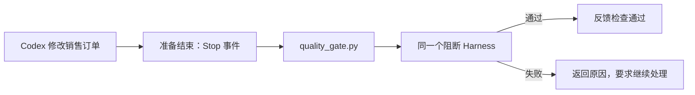

# L07｜用 Codex Hooks 建立本地护栏

有了统一 Harness，仍然可能忘记运行它。尤其在一次 Codex 会话中经过多次修改，最后一句“已完成”很容易让人忽略检查是否发生在最后一次改动之后。

本讲把检查连接到 Codex 的工作事件上，同时交付 FlowERP 的销售订单创建能力。我们关心的是：自动触发怎样减少遗漏，它的结果应如何解释，以及它不能保证什么。

## 本章学习地图

从订单金额错误出发，理解 Hook 的触发时点、输入输出和失败处理，再通过实际事件验证它是否生效。工作台新增本地自动检查入口；FlowERP 新增销售订单创建。人确认订单规则和 Hook 来源，Codex 实现功能，Hook 调用已有 Harness。

## 1. 自动检查应该发生在什么时候？

一张订单有两行商品：2 件每件 30 元，3 件每件 20 元，总额应为 120 元。若实现错误地只累加单价，就会得到 50 元。创建接口可能仍返回成功，页面也能显示订单编号。

已有验收可以识别这类问题，但需要有人调用。本讲把“准备结束一轮工作”作为触发点，在 Codex 给出最终交付说明前运行阻断检查。

**Hook** 是在指定事件发生时执行的程序。它与 Git Hook 不同：Git Hook 连接提交等 Git 事件，Codex Hook 连接 Codex 会话或工具事件。把文件放进 Git 的钩子目录，不会自动变成 Codex 的结束检查。

## 2. 仓库中的最小连接

本仓库用 `.codex/hooks.json` 注册 `Stop` 事件，调用 `.codex/hooks/quality_gate.py`。配置给出命令与超时；程序接收事件输入，运行统一阻断 Harness，再输出 Hook 协议要求的 JSON。



这个连接复用 L06 的业务检查，不在 Hook 中另写一套金额公式。否则，两套公式会形成新的不一致来源。

首次使用应审查配置将执行什么、在哪个目录执行，并在本机 Codex 中确认 Hook 已被信任。官方配置与事件行为会随版本变化，应以当前安装版本和[官方 Hooks 文档](https://learn.chatgpt.com/docs/hooks)核对，不能只凭配置文件存在判断运行过。

## 3. 两个退出结果为什么可能不同？

这里有两个程序：业务 Harness 与 Hook 适配程序。Harness 的非零退出码表示阻断检查失败；Hook 程序则需要成功把这个失败翻译为协议响应。

本仓库在业务检查失败时输出如下结构，原因文字取自实际检查输出：

```json
{
  "decision": "block",
  "reason": "阻断级 Eval 未通过，需根据失败输出修复后复验。"
}
```

对于当前 `Stop` 事件，官方文档中的 `block` 表示让 Codex 继续处理，而不是撤销已经发生的代码修改。仓库适配程序完成这次协议输出后可以返回 0；因此，不能把 Hook 程序的退出码单独当成业务绿灯。

还要防止无限续跑。仓库检查 `stop_hook_active`，在已经由 Hook 续跑过的情况下避免重复触发同一循环。这是一种防循环策略，也意味着它不是不可绕过的最终验收门：交付仍须核对实际报告，后续还会有 CI 与人工审核。

## 4. 触发成功不等于检查成功

下面几种故障需要分开判断。Hook 没被信任时，可能根本没有运行；运行目录错误时，Python 找不到模块；超时表示在限定时间内未拿到完整结果；业务断言失败才说明目标行为不满足要求。

如果这些情况都显示成“已检查”，界面会掩盖最需要处理的信息。工作台应保留事件与执行输出，并在缺少有效报告时说明没有完成验证。超时后的具体宿主行为要通过当前版本实测，不能假设所有 Hook 错误都会自动阻止交付。


图示表达多个入口复用同一检查结果。Hook 是其中一个触发入口；它不替代业务服务校验，也不能撤销先前已经完成的数据库操作。

## 5. 实践：由实际事件触发一次错误

先在隔离工作区完成订单创建的验收设计，覆盖正常金额、非法数量与失败时不生成残缺订单。激活虚拟环境，直接运行统一 Harness，确认输入数据与用例本身可工作。

```bash
python -X utf8 -m eval.harness --suite blocking
```

接着检查 Hook 命令实际选择的 Python 是否来自项目环境，并在 Codex 中审查、信任配置。提交一次范围受控的订单创建任务，保留结束事件及 Hook 输出。只手动调用脚本属于适配程序测试，还需要观察一次真实 `Stop` 事件。

在隔离副本中保留金额计算缺陷，观察 Hook 是否把阻断原因反馈给 Codex；修复后复验同一用例。**正常路径**应显示检查运行且通过。**失败路径**应显示具体失败并要求处理，不能仅返回泛化的“有问题”。

再通过独立测试模拟超时或命令不可用，记录当前宿主实际如何处理。合理的**失败后状态**是未获得业务绿灯、诊断信息保留、任务没有因此被人工接受。不要在共享配置里长期留下故障命令。

## 6. 复验与小结

提交订单增量、Hook 配置差异、实际触发记录和修复前后报告。**第二次签字**请同伴核对事件版本、运行目录与 Harness 结果，并判断“Hook 返回 0，内部验收失败”应该如何解释。

迁移问题：若某个工具已经写入文件，事后的 Hook 能否阻止这次写入？答案应从事件时点推导：它可以提供反馈，但预防副作用需要发生在执行前的权限或检查。

本地 Hook 减少检查遗漏。下一讲把同一套验收带到另一台执行机器，检验结果是否依赖开发者自己的环境。

## 配套实践与阅读

[行动卡](./tasks/L07-Codex-Hook.md) · [实践提示词](./labs/L07/prompts/README.md) · [提交模板](./labs/L07/SUBMISSION.md) · [课堂 PPT](<./slides/L07-用CodexHooks建立本地护栏.pptx>)

## 附录 A：本讲课程大纲合同

以下保留课程大纲的四项约定，供完成学习后核对。本讲对应 CLO-3：反例与可信质量证据。

- **核心内容**：生命周期 Hook、信任边界、超时、失败策略，以及 Hook 与 Git Hook 的区别。
- **演示结果**：Codex 在关键生命周期节点运行质量检查并反馈失败。
- **课内增量**：配置一个项目级质量 Hook，调用统一 Harness，而不是复制另一套质量逻辑。
- **通过标准**：Hook 来源可检查；故意引入违规时流程被阻断；恢复后重新通过。

## 本讲一手来源

> 核验日期：2026-09-04。来源用于解释机制，不改写课表主题、课程大纲合同或 FlowERP 通过标准。

- [OpenAI：Hooks](https://learn.chatgpt.com/docs/hooks)
- [Git：githooks](https://git-scm.com/docs/githooks)
- [OpenAI：Evaluation best practices](https://developers.openai.com/api/docs/guides/evaluation-best-practices)
