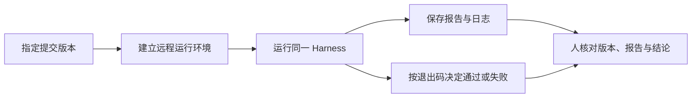

# L08｜把同一套 Eval 接入 CI

本地检查通过以后，别人仍可能无法复现：依赖没有声明、测试用了本机旧数据，或真正修改的文件没有进入提交。CI 的价值就在于从一个明确版本重新建立环境并运行同一套检查。

但 CI 也可能配置错误，把失败包装成成功。本讲同时验证业务实现与检查流程，交付 FlowERP 的原子预占，并让远程复验能如实保存失败。

## 本章学习地图

我们先用多行订单解释原子性，再分析假绿灯如何产生，最后完成“假绿 → 真红 → 真绿”的三次对照。工作台新增远程可复验的证据入口；Codex 协助修改业务与工作流，人分别审核两个范围。

## 1. 订单只预占一半，为什么是错误？

一张订单需要商品 A 两件、商品 B 三件。A 库存足够，B 只有两件。如果程序先预占 A，再发现 B 不足就报错，订单虽然失败，A 的可用库存却减少了。

这会让其他订单无法使用那两件 A，而系统中没有一张有效订单解释这次占用。正确行为是整张订单全部预占成功，或全部不改变库存。

**原子性**指这组相关变化作为一个整体生效。测试必须比较失败前后的所有相关库存与预占记录；只验证 B 没变，无法发现 A 已经被部分占用。

并发是另一个风险：两个请求可能都在旧库存上判断“足够”。实现需要把检查与写入放进合适的事务，并配合数据库约束。界面上依次点击成功，不能替代并发与回滚检查。

## 2. CI 到底复验了什么？

CI 是持续集成，这里指提交后由自动流程获取代码、安装环境并执行检查。它的起点是一个明确的提交版本，而不是开发者当前目录里未保存或未提交的内容。



CI 通过说明该版本在该流程与环境下通过了实际执行的检查。它不自动证明发布环境一致，也不证明检查覆盖完整。版本、命令与报告缺一项，都应缩小结论。

## 3. 为什么会出现假绿灯？

检查进程已经返回失败，但后续脚本忽略了它；或者工作流只检查报告文件存在，却读到了旧文件。这两种情况下，业务仍然错误，远程页面却可能显示绿色。

因此，本讲用三次受控运行区分两个因果关系：

| 运行 | 业务实现 | CI 行为 | 应学到什么 |
|---|---|---|---|
| A | 保留原子预占缺陷 | 故意吞掉失败，出现假绿 | 绿色界面可能来自错误配置 |
| B | 保持同一业务缺陷 | 修正状态传播，真实报红并上传报告 | CI 能发现并保存失败 |
| C | 修复业务缺陷 | 保持 B 的 CI 规则 | 同一套检查真实通过 |

A 是隔离教学实验，必须清楚标注，不能作为可发布结果。B 到 C 才检验业务修复。若同时改业务、删测试、调整 CI，很难判断绿灯来自哪里。

## 4. 保存失败与传播失败是两件事

工作流需要在检查失败后仍上传报告，方便定位问题；同时保持任务失败状态，防止后续把它当成可接受版本。不能因为“上传成功”覆盖原检查失败。

报告还要关联来源提交与运行编号。文件哈希可以检查报告字节是否变化，但不能凭一个哈希确认报告确实来自可信远程执行。应结合平台运行记录、提交版本和工作流内容交叉核对。

仓库的 `workbench/ci_evidence.py` 与 `CI_GATE_SPEC.md` 承接这些约定。阅读它们时重点检查缺少报告、版本不匹配与退出码不一致的处理，不必先记住每个元数据字段。


图中展示了修复后的证据入口。本讲作业需要自己保存三次运行，而不是只呈现最后一次成功截图。

## 5. 实践：让另一台执行器得出相同结论

先在隔离工作区设计两行订单失败回滚用例，再补充全部足够的正常订单。激活虚拟环境，在本地运行：

```bash
python -X utf8 -m unittest tests.test_ci_evidence -v
python -X utf8 -m eval.harness --suite blocking
```

第一条检查 CI 证据的约定，第二条运行业务和工程阻断检查。随后在自己的课程仓库按行动卡配置远程工作流；此时需要能访问所选 CI 平台。本地模拟可以用于调试，但最终应注明哪些结果真正发生在远程环境。

依次完成 A、B、C，保留各自的提交标识、工作流版本、检查退出码、报告与运行入口。B 必须能下载失败报告。再做一次缺少报告的实验，确认没有报告时不会沿用旧绿灯。

**正常路径**是 C：原子预占满足要求，远程报告与结论一致。**失败路径**是库存不足或证据缺失。业务的**失败后状态**应保持所有相关预占不变；交付状态则应明确失败并保留诊断材料。

如果只在本地通过，先比较代码版本、依赖和测试数据，再判断业务原因。不要用远程多次重跑偶然得到的绿色覆盖稳定失败。

## 6. 复验与小结

**第二次签字**请同伴从运行 B 的远程记录找到目标提交，并解释为什么它比 A 的绿灯更可信。迁移练习是设计“检查进程崩溃且没有报告”的处理流程：哪些步骤仍需执行，最终状态为何不能通过？

CI 将复验从个人环境移到可重复的流程。真正有价值的结果，是失败时可靠失败、成功时有证据说明成功。下一讲把失败报告转化为下一次最小修复的输入。

## 配套实践与阅读

[行动卡](./tasks/L08-CI远程复验.md) · [实践提示词](./labs/L08/prompts/README.md) · [提交模板](./labs/L08/SUBMISSION.md) · [课堂 PPT](<./slides/L08-把同一套Eval接入CI.pptx>)

## 附录 A：本讲课程大纲合同

以下保留课程大纲的四项约定，供完成学习后核对。

- **核心内容**：本地快速反馈与远程可信复验；候选分支、报告归档和人工合并。
- **演示结果**：不合格变更在 CI 中失败，修复后生成通过报告。
- **课内增量**：配置 CI 工作流并上传 Harness 报告。
- **通过标准**：本地与 CI 使用同一入口；非零退出码阻断候选变更；自动修复不直接合并主分支。

## 本讲一手来源

> 核验日期：2026-09-04。来源用于解释机制，不改写课表主题、课程大纲合同或 FlowERP 通过标准。

- [GitHub：Workflow syntax](https://docs.github.com/en/actions/writing-workflows/workflow-syntax-for-github-actions)
- [GitHub：Workflow artifacts](https://docs.github.com/en/actions/concepts/workflows-and-actions/workflow-artifacts)
- [GitHub：Security hardening](https://docs.github.com/en/actions/security-for-github-actions/security-guides/security-hardening-for-github-actions)
