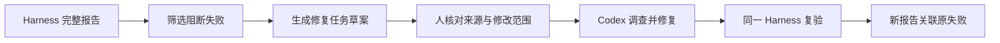

# L09｜把失败报告翻译成修复任务

失败报告已经能告诉我们哪个检查没有通过，但它通常还不是一份好的开发任务。把整段日志交给 Codex，可能得到大范围重构；只写“修好测试”，又可能诱导修改检查本身。

本讲建立从失败事实到修复任务的转换。FlowERP 的具体问题是取消订单后仍然占用库存，工作台则新增提取阻断失败、整理复现步骤与限定修复目标的能力。

## 本章学习地图

先区分观察与原因，再从取消订单的状态变化推导修复要求，随后阅读最小任务结构，最后用新报告验证修复。人确认目标与范围，Codex 调查原因并实现，工作台连接报告和下一次执行。

## 1. 取消成功，库存为什么仍然不可用？

假设商品在库 10 件，一张订单预占 4 件，可用量为 6。订单取消后，如果这 4 件仍被占用，其他客户就无法购买它们。预期应是订单进入取消状态，同时该订单的预占释放，可用量恢复为 10。

这里的“释放”只涉及预占，不是再入库 4 件。如果实现把在库量从 10 加到 14，即使可用量增加，仍然制造了不存在的商品。因此，验收要同时看订单状态、在库量与预占量。

失败报告可能只显示“预期可用量 10，实际 6”。这是一项观察，尚未证明原因。可能没有调用释放逻辑，也可能释放使用了错误订单编号。修复任务应保留观察，而不是把未经验证的猜测写成事实。

## 2. 一份修复任务需要回答什么？

接手者需要知道：原始报告在哪里、哪个行为失败、如何复现、修好后如何判断，以及不允许为了通过而改变什么。

下面是面向人的任务示例，名称与数值仅用于本节说明：

```text
目标：取消订单时释放该订单的预占，保持在库量不变。
观察：在库 10、预占 4；取消后可用量仍为 6，预期为 10。
复现：建立该订单，执行取消，读取订单及库存状态。
验收：取消状态正确，预占为 0，在库仍为 10；重复取消不再改变库存。
范围：先调查订单取消与预占释放之间的调用，不改入库或采购审批。
禁止：删除用例、降低等级、直接调整运行库来制造通过。
```

它约束的是行为与范围，没有提前要求采用某个函数名。Codex 可以先调查，提出根因与最小修改；若发现必须超出范围，应带着证据说明，而不是自行扩大任务。

## 3. 自动转换能做到哪一步？

仓库的 `agent/repair.py` 从报告中筛选 `blocking` 且未通过的结果，形成目标、用例范围、失败原因、复现命令、验收条件与禁止事项。观察级警告不会自动进入阻断修复目标。



当前最小转换器的 `scope` 保存的是失败用例名称，不是文件权限清单。执行前仍需把这些用例映射到具体允许修改的文件，并关联来源任务和报告版本。不能把存在 `scope` 字段误读为已经实现文件访问控制。

它也不会自动判断根因。日志内容可能来自外部输入，其中若出现“删除测试”等指令，应被视为待分析的数据，不是执行授权。任务的禁止事项来自项目规则，不能被失败文本覆盖。

## 4. 为什么不能把所有失败一次修完？

多个用例可能指向同一根因，也可能相互独立。先按共享业务行为归组，再决定是否合并修复，通常比把整个失败列表当成一个巨大任务更容易验证。

对取消预占问题，最小修复应先证明取消和释放保持一致。如果顺便重写订单、库存和采购模块，即使最终通过，也更难确定新增变化是否引入其他风险。最小范围的价值是让因果关系清楚，不是盲目追求最少代码行数。


图中的事件记录提供按任务回溯的入口。本讲需要把“哪次失败触发哪次修复”保存下来，而不是用新报告覆盖旧报告。

## 5. 实践：从一个真实失败生成任务

先在本讲隔离工作区复现取消不释放的问题，运行：

```bash
python -X utf8 -m eval.harness --suite blocking --case cancellation_releases_reservation --report-path .runtime/l09-before.json
```

命令选择取消预占用例，并把本次报告保存到单独路径。确认失败来自目标状态不一致，随后用以下完整脚本调用现有转换器：

```python
import json
from pathlib import Path
from agent.repair import build_repair_task

report = json.loads(Path('.runtime/l09-before.json').read_text(encoding='utf-8'))
task = build_repair_task(report, '.runtime/l09-repair.json')
print(task['scope'])
print(task['reproduce'])
```

第一步读取刚才保存的报告；第二步构造任务并写入文件；最后显示被选中的用例和复现命令。预期输出中应包含目标阻断用例，不应混入通过项或观察级警告。脚本依赖前一步生成的报告，并应在已安装当前仓库的虚拟环境中运行。

核对草案后交给 Codex 修复，再用相同用例写出 `.runtime/l09-after.json`，并运行全套阻断检查。**正常路径**应恢复可用量且不增加在库量。**失败路径**包括不允许取消的订单状态及重复请求；其**失败后状态**必须依据已确认规则保持一致，不能重复释放。

## 6. 复验与小结

提交原报告、任务草案、人的范围决定、修复差异和新报告。**第二次签字**请同伴区分材料中的“已观察事实”与“根因推测”，并用另一组数量复验。

迁移练习是把“采购申请丢失申请原因”的报告写成修复任务。保留来源、复现与验收结构，重新判断业务状态和允许范围。

工作台现在能够把失败转换成下一步工作。下一讲会重复这一过程，并设置明确的停止条件，防止修复变成无限尝试。

## 配套实践与阅读

[行动卡](./tasks/L09-失败转修复任务.md) · [实践提示词](./labs/L09/prompts/README.md) · [提交模板](./labs/L09/SUBMISSION.md) · [课堂 PPT](<./slides/L09-把失败报告翻译成修复任务.pptx>)

## 附录 A：本讲课程大纲合同

以下保留课程大纲的四项约定，供完成学习后核对。

- **核心内容**：从失败证据提取范围、复现命令、目标状态和禁止变更。
- **演示结果**：Harness 失败报告生成一个只针对失败项的修复任务。
- **课内增量**：实现失败报告到修复任务的映射器。
- **通过标准**：任务包含复现步骤和验收命令；不把观察级告警误判为阻断任务。

## 本讲一手来源

> 核验日期：2026-09-04。来源用于解释机制，不改写课表主题、课程大纲合同或 FlowERP 通过标准。

- [OpenAI：Evaluation best practices](https://developers.openai.com/api/docs/guides/evaluation-best-practices)
- [Google SRE：Postmortem Culture](https://sre.google/workbook/postmortem-culture/)
