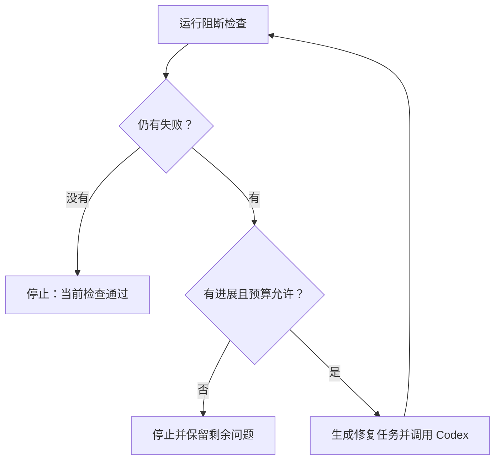

# L10｜建立有停止条件的修复 Loop

L09 已经建立“失败报告 → 修复任务 → Codex 修改 → 再次检查”的过程。把它重复执行，就得到修复 Loop，也就是有反馈的循环。

循环可以减少人重复搬运报告的工作，但重复不等于进展。若同一错误一直存在，继续消耗时间与调用额度并不会自动提高交付质量。本讲研究如何让循环在有依据时继续，在应当停止时如实停止。

## 本章学习地图

以订单状态迁移为业务案例，理解一轮循环的输入输出、停止条件和历史记录，再观察仓库最小 Loop 的实际能力与边界。

FlowERP 本讲明确合法订单状态迁移；工作台新增有轮数、时间与用量边界的修复流程。人确定允许修复的行为与资源范围，Codex 执行最小变更，Harness 提供反馈。

## 1. 状态名称不是任意标签

订单的状态表示已经发生哪些业务事实。新订单、已预占、已履约和已取消之间存在先后关系。例如，已经取消的订单不应重新作为正常订单继续履约；不能只因为目标状态是合法单词，就允许写入。

**状态迁移**是从当前状态到下一状态的变化。判断必须同时使用当前状态与请求动作，并检查相关库存变化是否一致。本课程的具体迁移集合以领域模型与 Spec 为准，不另造一套页面规则。

修复任务可能来自一条非法迁移被接受的失败报告。Codex 修改以后，要复跑原反例，也要检查合法流程仍然可用。只把所有状态变更都拒绝，会让反例通过，却破坏正常业务。

## 2. 一轮循环包含什么？

本仓库每轮先运行阻断 Harness，提取未通过用例；若仍有失败，生成修复任务，再决定是否调用 Codex。下一轮重新检查修改后的状态。



因此，一轮执行器返回成功不代表循环收敛。只有后续检查没有阻断失败，才能说明在当前验收范围内收敛。若最后一轮刚做完修改却没有再次检查，应保留“尚待复验”的事实。

## 3. 停止条件怎样选择？

最直观的条件是最大轮数。本讲默认最多三轮，用于限制一次自动尝试的规模。达到上限仍有失败，就输出剩余问题；不能把“程序正常跑完三轮”标为业务成功。

第二个条件是没有进展。仓库用未通过用例名称的集合进行比较：连续两轮相同，就返回 `stopped_no_progress`。这种方法简单，但比较粗糙——同一用例的错误可能已经从一个原因变成另一个原因，名称相同不代表完全没有改善。停止后应由人阅读差异，决定是否重新调整任务。

第三类是时间和调用用量。时间限制控制一次运行占用多久；token 用量表示模型处理的输入输出规模，用于约束调用成本。用量缺失不能当成零，本仓库会在执行器未返回可核验用量时停止。

预算检查也有边界：一次调用可能让累计用量越过阈值，程序据此不再开始下一轮。这不等于提供精确的账单硬上限。阅读实现时要分清“开始下一轮的条件”与“当前调用的资源限制”。

## 4. 历史记录比最后一句结论更重要

每一轮应保存输入报告、失败集合、修复任务、执行结果与资源消耗。这样才能回答：失败是否减少，是否反复修改同一区域，停止是因为通过还是预算耗尽。


图中的事件序列帮助还原过程。仅保存最后一轮会丢失前几轮的判断依据，也会使后续调整任务缺少上下文。

循环还可能遇到执行器异常。实现应将异常、最后已知报告及未完成动作保存为明确失败；不能因为没有得到新报告就继承旧成功。当前最小 Loop 对部分执行异常仍需调用方结合原始日志处理，这也是复验时应检查的边界。

## 5. 实践：先观察，再授权修改

在激活虚拟环境的隔离工作区中运行：

```bash
python -X utf8 -m agent.loop --max-rounds 3
```

默认命令只检查并生成修复任务，不调用 Codex 修改代码。若仓库已经全绿，可能第一轮就结束；若存在稳定失败，可能因无进展停止。这两种结果都不证明发生过自动修复。

确认 Spec、允许范围与当前失败后，可在自己的隔离练习中显式启用执行：

```bash
python -X utf8 -m agent.loop --max-rounds 3 --timeout 900 --token-budget 30000 --codex
```

`--codex` 允许本机 Codex 执行修复，依赖已有的本机配置；其他参数分别限制轮数、时间与累计用量。本课程的业务测试本身不依赖外部服务，实际模型执行则需要可用的 Codex 环境。

**正常路径**应在修复非法迁移后重新通过检查。**失败路径**至少覆盖稳定重复失败和预算不足，可以使用执行器测试注入固定响应，不必为了验证停止逻辑消耗真实额度。合理的**失败后状态**是停止原因明确，剩余失败与已经发生的修改保留，任务等待人的下一步决定。

## 6. 复验与小结

提交一次收敛过程与一次停止过程，解释每轮依据。**第二次签字**请同伴检查某次停止是否符合实际报告，而非只认可状态字段。

迁移练习：同一用例连续两轮失败，但错误原因不同，该不该继续？说明还需要哪些观察，避免把固定轮数或失败数量当成唯一质量指标。

Loop 负责重复一个有边界的过程。下一讲考虑另一种提效方式：将独立工作并行执行，并处理并行所引入的协调成本。

## 配套实践与阅读

[行动卡](./tasks/L10-有界Loop.md) · [实践提示词](./labs/L10/prompts/README.md) · [提交模板](./labs/L10/SUBMISSION.md) · [课堂 PPT](<./slides/L10-建立有停止条件的修复Loop.pptx>)

## 附录 A：本讲课程大纲合同

以下保留课程大纲的四项约定，供完成学习后核对。本讲对应 CLO-4：受控返工。

- **核心内容**：最大轮数、达标即停、无进展检测、时间与 Token 预算、安全退出。
- **演示结果**：修复循环成功收敛一次，并展示一次未收敛退出。
- **课内增量**：串联“执行 → Eval → 生成修复任务 → 再执行”。
- **通过标准**：最多三轮；达标即停止；无进展或预算耗尽时输出剩余失败，不宣称成功。

## 本讲一手来源

> 核验日期：2026-09-04。来源用于解释机制，不改写课表主题、课程大纲合同或 FlowERP 通过标准。

- [Google SRE：Automation at Google](https://sre.google/sre-book/automation-at-google/)
- [OpenAI：Codex non-interactive mode](https://learn.chatgpt.com/docs/non-interactive-mode)
- [OpenAI：Evaluation best practices](https://developers.openai.com/api/docs/guides/evaluation-best-practices)
