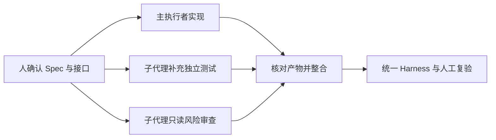

# L11｜用 Codex 原生 Subagents 并行处理独立任务

处理采购申请时，既要实现业务行为，也要补充测试和检查风险。这些工作有一部分可以同时进行，但“同时”并不天然更快：如果多个执行者争相修改同一逻辑，整合成本可能超过节省的时间。

本讲使用 Codex 原生 Subagents，把能够独立开展的任务并行化。重点是如何划分任务和验收结果，而不是增加代理数量。

## 本章学习地图

我们先明确采购申请的业务增量，再比较可并行与不可并行的工作，最后设计输入、写入范围、输出与整合复验。

FlowERP 新增采购申请；工作台新增并行任务的边界记录与结果汇合方式。学生负责拆分和合并决策，Codex 的主执行者与子代理按约定协作，统一 Harness 检查合并后的结果。

## 1. 先把采购申请与入库区分开

库存不足时，采购申请表达“希望采购什么、多少、为什么”。创建申请并不代表采购已经批准，更不代表商品已经收到。若创建申请就增加库存，后续审批与收货便失去意义。

本讲应保存申请所需字段，检查数量等输入，保留申请原因，并使申请进入约定的待处理状态。审批后才能入库的完整控制将在下一讲继续验证。

这里至少有三项可安排的工作：实现申请行为、为已确认接口补充测试、只读检查是否绕过审批。第三项不必等待最终代码才开始，可以先检查当前结构与风险位置。

## 2. 什么才叫独立任务？

两个任务写不同文件，只解决了部分冲突。例如，一个代理修改接口参数，另一个按旧参数编写测试，文件没有重叠，结果仍然无法组合。这是语义依赖。

因此，每个任务需要约定输入版本、接口假设、允许读取和修改的位置，以及应返回的产物。对尚未确定的接口，先串行确认，再并行实现测试与风险审查。

| 分工 | 输入与范围 | 输出 |
|---|---|---|
| 主执行者 | 已确认的采购申请 Spec；业务实现范围 | 最小实现与说明 |
| 测试子代理 | 固定接口与独立测试文件范围 | 正常、失败用例与运行结果 |
| 风险子代理 | 相同基线，只读审查 | 风险位置、依据及待确认问题 |

这是一种可用分工，不是每次都需要三个角色。任务很短或接口仍在频繁变化时，单个执行者通常更容易保持一致。

## 3. Subagents 改变了什么？

Subagent 是主任务委托出去的子执行者。Codex 可以让它处理独立工作，再把结果交回主任务。每个子代理也会进行模型与工具调用，因此需要考虑额外用量。[Codex Subagents 官方说明](https://learn.chatgpt.com/docs/agent-configuration/subagents)



主任务应收到可核对的产物：修改文件、测试结果和发现依据。只有“已完成”“没有问题”这样的总结，难以支持整合判断。

子代理完成也不表示系统完成。局部测试可能通过，但与另一处改动结合后失效，因此必须对合并后的版本运行统一验收。任何一个参与者的自述都不能代替这个步骤。

## 4. 如何提出一份可执行的并行委托？

先确认当前客户端支持并行子代理，再明确提出委托。下面的提示词是工作说明模板，文件范围应替换成你实际确认的位置。

```text
请使用 Codex 原生子代理处理两个独立任务。
共同输入：已确认的采购申请 Spec 和当前基线版本。
任务一：只在约定的独立测试文件中补充正常与失败用例，不修改业务实现。
任务二：只读检查采购申请是否可能直接改变库存，给出代码位置和依据。
主任务负责业务实现与最终整合。若接口或写入范围发生冲突，先报告并停止冲突部分。
每项结果说明检查了什么、发现了什么，以及未验证的部分。
```

这份委托首先固定共同输入，再指定行为边界，最后规定结果形态。不要让两个代理同时“修复所有问题”，否则它们很可能争用同一范围。

## 5. 实践：比较局部通过与整体通过

在本讲隔离工作区完成拆分，保存任务分工和接口决定。观察各子任务的修改位置；发现重叠或接口变化时，停止冲突部分，重新安排顺序。


图中是后续参考系统的采购界面。当前重点是申请记录本身，不把看到审批按钮当成本讲已经完成审批控制。

整合后激活虚拟环境运行：

```bash
python -X utf8 -m eval.harness --suite blocking --case purchase_request_preserves_reason
python -X utf8 -m eval.harness --suite blocking --case write_sets_reject_conflict
```

前者检查采购申请相关约定，后者检查仓库对写集冲突的检查能力。通过它们以后，还需运行全套阻断检查，核对整合后的实际行为。

**正常路径**是独立产物成功整合，申请信息保留且库存未增加。**失败路径**可以主动安排两项任务申请同一写入范围，只测试冲突检测，不让它们实际互相覆盖。合理的**失败后状态**是冲突被记录并重新分配，原有产物可追溯。

记录并行时间、整合时间和可取得的调用用量；无法取得用量时写明缺失，不推算一个貌似精确的节省比例。并行是否值得，应依据完整成本判断。

## 6. 复验与小结

**第二次签字**请同伴审查任务间是否存在未声明依赖，并在合并版本上复验。迁移练习是把“修改业务接口”与“实现调用页面”拆分：哪些部分可以提前并行，哪些必须等待接口确定？

并行让独立工作同时发生，工作台则负责让它们仍然属于同一次可验证交付。下一讲把执行、失败回退与人工审核明确表示为状态图。

## 配套实践与阅读

[行动卡](./tasks/L11-Subagents并行.md) · [实践提示词](./labs/L11/prompts/README.md) · [提交模板](./labs/L11/SUBMISSION.md) · [课堂 PPT](<./slides/L11-用Codex原生Subagents并行处理独立任务.pptx>)

## 附录 A：本讲课程大纲合同

以下保留课程大纲的四项约定，供完成学习后核对。

- **核心内容**：可并行任务识别、上下文隔离、结果汇总、冲突风险与额外 Token 成本。
- **演示结果**：测试补全与风险审查并行执行，由主 Agent 汇总结论。
- **课内增量**：为两个无文件写入冲突的任务定义清晰输入、输出和验收标准。
- **通过标准**：子任务边界清晰；主 Agent 能追溯每个结论；有写入冲突的任务不强行并行。

## 本讲一手来源

> 核验日期：2026-09-04。来源用于解释机制，不改写课表主题、课程大纲合同或 FlowERP 通过标准。

- [OpenAI：Subagents](https://learn.chatgpt.com/docs/agent-configuration/subagents)
- [Git：git-worktree](https://git-scm.com/docs/git-worktree)
- [OpenAI：Evaluation best practices](https://developers.openai.com/api/docs/guides/evaluation-best-practices)
