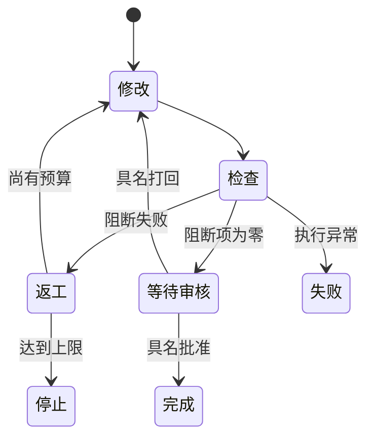

# L12｜用 Graph 显式表达状态、回退和人工审核

修复循环可以处理反复修改，但交付过程并不总是“失败就再试一次”。有时必须等待人确认，有时可以回退，有时发生异常后应停止。把这些情况埋在多层条件语句中，会越来越难解释当前进度。

本讲用 Graph，即状态与转移构成的图，显式表达交付过程。同时在 FlowERP 中落实采购经具名审批后才能入库的业务要求。

## 本章学习地图

先区分业务审批和研发验收，再推导状态、转移与持久化，最后用等待、打回、恢复和异常实验验证流程。

工作台新增可观察的状态图与人工审核点；FlowERP 新增受审批约束的采购入库流程。Codex 可以实现规则和运行检查，批准采购与接受交付仍由相应责任人决定。

## 1. 两种人工决定不能合并

采购负责人批准的是一笔业务：是否同意采购这些商品。交付复验者接受的是一版软件：采购审批规则是否被正确实现。两者对象、依据和责任都不同。

例如，软件通过了“未审批不能入库”的测试，并不表示某一笔真实采购已获批准。反过来，一笔采购有批准记录，也不能证明系统对其他未经批准的请求一定会拒绝。

因此，需要在业务数据中保存审批人和决定，在研发任务中保存交付审核人和证据。把它们都写成一个 `approved`，会让后续程序不知道究竟批准了什么。

## 2. 用状态图表达可发生的下一步

一个状态应表示可解释的事实，例如“等待人工审核”，而不是模糊的“处理中”。转移则需要条件与原因：检查通过才能进入审核；审核打回则回到修改；预算耗尽则停止。



图的价值是暴露问题：从哪里可以进入完成，谁能触发，失败后去哪里。如果存在“检查失败直接完成”的边，就应解释它的业务依据；通常这正是流程错误。

不必为了画图引入庞大框架。仓库用 Python 状态对象、分支和转移记录实现最小 Graph。重要的是转移规则可检查，当前状态能保存，恢复后不会重复越过关键决策。

## 3. 持久化为什么改变了流程要求？

**持久化**指把状态保存到进程退出后仍存在的存储中。仅在内存里等待审核，关闭程序后就无法知道上次等待哪一版结果；重新运行可能从头开始，甚至重复执行有副作用的操作。

状态记录应关联任务、报告与被审核的版本。审核决定也应有对象和时间。若实现后又修改了代码，原先批准不能无限沿用。

仓库的 `agent/graph.py` 保存状态、轮数、报告、转移轨迹和审核信息。它是最小流程示例：`develop` 状态并不会自己调用 Codex 完成真实修改；默认无持久化演示模式还允许自动审核通过。因此，观察图跑到 `completed` 不能单独证明完成过真实的人机协作交付。


图中展示具名审核的位置。有效审核必须能回到本次报告与对应版本，不能只有一个被点击过的按钮。

## 4. 实践：先停在等待，再由人作决定

在隔离工作区、激活虚拟环境后运行：

```bash
python -X utf8 -m agent.graph --max-rounds 3 --require-human-review --state-file .runtime/l12-review.json
```

若阻断项为零，预期状态为 `awaiting_human_review`，命令退出码为 3，表示等待，并非业务失败或完成。若仍有阻断失败，应先处理或保留停止结果，不能直接签收。

阅读状态文件，核对报告与当前代码。关闭并重新运行同一命令，确认等待状态保留。实际审核者决定接受后，使用自己的真实姓名填写命令中的审核人字段：

```bash
python -X utf8 -m agent.graph --max-rounds 3 --require-human-review --state-file .runtime/l12-review.json --review-decision approve --reviewer "填写实际审核人"
```

这里的姓名是待替换输入，不是可直接提交的审核身份。再用独立实验文件验证 `reject` 打回路径与剩余轮数；不要覆盖已经完成的一次真实审核。最小文件记录也不提供身份认证，正式系统需要在接口与权限层补齐。

## 5. 回到采购业务检验图的价值

建立一笔采购申请，在未审批时尝试入库。预期请求被拒绝，库存与入库流水不变。随后由具有责任的审批人确认，再执行入库，观察对应数量和业务记录。重复请求还要遵守 L05 的幂等约定。

```bash
python -X utf8 -m eval.harness --suite blocking --case purchase_requires_approval
```

**正常路径**包括已审批入库与经过具名审核的研发交付。**失败路径**包括未审批入库、非法状态转移、审核打回与执行异常。分别写出**失败后状态**：业务拒绝不应改变库存；流程异常应记录原因；打回应保留上一轮报告并进入允许的修订阶段。

这些实验可以暴露状态图与实际代码不一致的地方。若图上写着等待人，程序却自动进入完成，应修正实现或明确它只是演示模式，不能用图代替事实。

## 6. 复验与小结

提交业务审批记录、状态图、等待与恢复实验，以及异常路径。**第二次签字**请同伴从一条转移记录找出其依据，并检查批准对象是否仍对应当前结果。

迁移练习：发布流程需要在测试通过后等待负责人决定发布时间。哪些状态可以复用，哪些动作不应在恢复时重复？

状态图把过程中的选择显式化。下一讲为这个过程提供任务 API，使界面与其他程序能够提交工作并查询进度。

## 配套实践与阅读

[行动卡](./tasks/L12-Graph与人工审核.md) · [实践提示词](./labs/L12/prompts/README.md) · [提交模板](./labs/L12/SUBMISSION.md) · [课堂 PPT](<./slides/L12-用Graph显式表达状态、回退和人工审核.pptx>)

## 附录 A：本讲课程大纲合同

以下保留课程大纲的四项约定，供完成学习后核对。本讲对应 CLO-5：跨角色协作与人审。

- **核心内容**：共享状态、条件分支、审核打回、异常路径和人工介入；原生 Subagents 与外部编排框架的边界。
- **演示结果**：开发 → 测试 → 审核；审核失败回到开发，关键决策等待人工确认。
- **课内增量**：用最小 Python 状态图实现移交、回退、状态保存和审核结论。
- **通过标准**：状态变化可追踪；审核结果来自 Eval；循环有上限；异常不会被静默忽略。

## 本讲一手来源

> 核验日期：2026-09-04。来源用于解释机制，不改写课表主题、课程大纲合同或 FlowERP 通过标准。

- [OpenAI：Subagents](https://learn.chatgpt.com/docs/agent-configuration/subagents)
- [Google SRE：Automation at Google](https://sre.google/sre-book/automation-at-google/)
- [SQLite：Atomic Commit](https://www.sqlite.org/atomiccommit.html)
