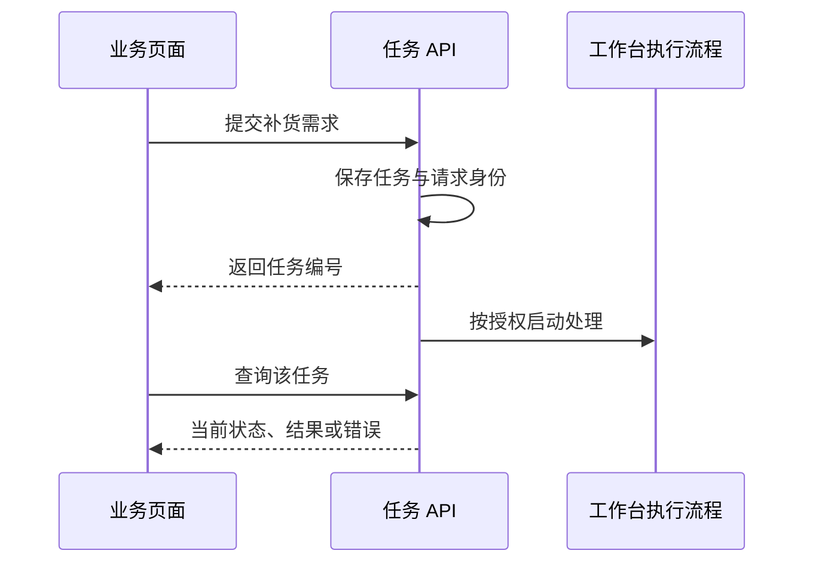

# L13｜把执行链路封装成任务 API

目前，交付过程主要通过命令启动。若采购人员需要在页面提交一项补货需求，页面不应直接承担执行 Codex、运行测试和等待审核的全部逻辑。

本讲把已有执行链路封装为任务 API。API 是供程序调用的接口；它把“提交工作”和“查询结果”变成明确约定，并把长时间运行与页面请求分开。

## 本章学习地图

我们从补货需求提交推导任务身份、异步响应、状态查询和持久化，再核对当前仓库的真实接口，最后验证重复提交、未知任务与重启行为。

FlowERP 的补货需求获得可追踪的提交入口；工作台新增任务创建与查询能力。业务人员描述需求，Codex 协助形成 Spec 和实现，工作台承接执行状态，审核者接受最终结果。

## 1. 收到请求与完成工作是两个时点

一项需求可能需要数分钟执行，之后还要等待人审。如果页面始终保持一次 HTTP 请求，就容易因超时失去结果；用户重试时，又可能重复创建任务。

更合适的做法是先持久化任务，返回任务编号，再由客户端查询进度。**异步**在这里指调用者不用等待全部工作完成，就可以取得后续查询入口。它不表示任务会自动成功，也不表示后台一定已经开始执行。



采购申请、研发任务和 HTTP 请求也不是同一对象。一个客户需求可以触发研发任务，但任务被接受不等于采购已审批，更不等于库存已增加。

## 2. 最小接口约定包含什么？

创建接口需要需求内容与来源，返回稳定任务编号；查询接口根据编号返回状态、结果引用和错误。状态应来自持久化记录，不能每次刷新重新推算一份与执行过程无关的“进度”。

请求无效时，应直接说明字段问题；任务不存在时，返回不存在；任务执行失败时，应能查到这个已存在任务及失败原因。不能把三者都写成“服务异常”。

若客户端没有收到创建响应，会尝试重发。可以使用提交幂等键识别同一次请求。同键同内容应回到原任务；同键不同内容应报告冲突。它复用了 L05 的思想，但这里保护的是任务创建，而非库存入库。

## 3. 设计约定与当前仓库接口

跟跑工作台运行在 `:8001`，任务存储位于它自己的 `workbench.db`。当前实现同时保留同步校验入口与异步需求入口，应按实际行为使用：

| 接口 | 当前作用 |
|---|---|
| `POST /api/v1/tasks` | 创建并进行校验，返回 201；不是本例的异步入口 |
| `POST /api/v1/delivery/requests` | 接收需求并返回 202 与查询入口 |
| `GET /api/v1/tasks/{任务编号}` | 查询已保存的任务 |

202 表示已接收处理，不是交付完成。异步入口当前默认只允许 `verify`，即运行已有能力的校验；不能据此声称网页已经授权 Codex 编写新功能。真实代码执行需使用课程规定的显式授权入口。

`workbench/task_store.py` 保存任务、事件、版本与审核信息，并限制状态迁移。网页服务只是调用这些能力，不应另建一套与任务存储不同的状态规则。


图中任务编号把需求与结果连接起来。它的用途是定位同一次工作，不能由一个成功状态推断所有业务操作都已完成。

## 4. 实践：从标准库客户端查询一个任务

按行动卡启动自己的隔离工作台实例，并确认端口与运行目录。下面是完整的读取脚本，可在已安装项目的环境中运行；它不创建任务，也不修改业务数据。

```python
import json
from urllib.request import urlopen

task_id = input('输入工作台返回的任务编号：').strip()
url = f'http://127.0.0.1:8001/api/v1/tasks/{task_id}'
with urlopen(url, timeout=10) as response:
    task = json.load(response)
print(task['id'])
print(task['status'])
```

脚本读取真实任务编号，向 API 发起查询，将 JSON 转成 Python 数据，再显示身份与状态。编号应来自创建响应，不使用讲义中的虚构编号。未知编号会触发 HTTP 错误，这是需要验证的失败结果；进一步可按操作手册捕获并展示它。

创建请求的完整字段、来源关联与幂等键见配套行动卡。先记录创建响应，再查询到等待审核或失败。重启服务后查询同一编号，确认任务仍存在；不要通过重新创建一个任务来冒充恢复成功。

## 5. 为什么有数据库还要测试并发？

两个请求可能同时查询到“尚不存在”，然后各自创建一个任务。只在应用代码中先查后写，并不自动保证幂等。需要数据库约束与一致的事务处理，并用并发或受控交错实验验证。

状态更新也可能冲突：一个请求提交审核，另一个还在更新旧结果。版本字段可以帮助识别陈旧更新，但是否真正拒绝冲突，要看更新条件与测试，不能只看数据表里有一个 `version`。

**正常路径**是有效请求取得稳定编号，查询结果与存储一致。**失败路径**包括空需求、未知编号、重复键冲突与非法状态迁移。合理的**失败后状态**是没有半成品任务、原任务不被冲突请求覆盖，已发生的失败可以查询。

## 6. 复验与小结

提交接口约定、请求响应、重启前后记录与失败实验。**第二次签字**请同伴独立提交或查询，在 API 响应与持久化状态之间核对同一任务。迁移练习：批量导出需要十分钟，应在哪个时点返回什么，客户端断开后如何找回结果？

API 将工作台能力变成可调用的服务。下一讲为这些状态提供可操作的页面，并检查页面展示与后端事实是否一致。

## 配套实践与阅读

[行动卡](./tasks/L13-任务API.md) · [实践提示词](./labs/L13/prompts/README.md) · [提交模板](./labs/L13/SUBMISSION.md) · [课堂 PPT](<./slides/L13-把执行链路封装成任务API.pptx>)

## 附录 A：本讲课程大纲合同

以下保留课程大纲的四项约定，供完成学习后核对。

- **核心内容**：任务模型、异步执行边界、状态机、持久化和最小权限。
- **演示结果**：提交任务后获得 ID，并查询 Spec、执行阶段和最终结果。
- **课内增量**：实现任务提交与状态查询两个最小接口。
- **通过标准**：状态只按合法路径变化；失败原因可查询；已完成任务在服务重启后仍可读取。

## 本讲一手来源

> 核验日期：2026-09-04。来源用于解释机制，不改写课表主题、课程大纲合同或 FlowERP 通过标准。

- [RFC 9110：HTTP Semantics](https://www.rfc-editor.org/rfc/rfc9110.html)
- [RFC 9457：Problem Details for HTTP APIs](https://www.rfc-editor.org/rfc/rfc9457.html)
- [SQLite：Atomic Commit](https://www.sqlite.org/atomiccommit.html)
