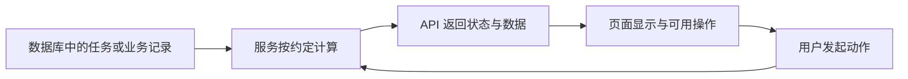

# L14｜让交付状态在 Web 面板可见

API 已能返回任务状态，但使用者还需要看懂它，并知道下一步可以做什么。本讲为个人工作台和 FlowERP 建立各自的页面入口，把交付状态与业务操作变成可观察、可核对的界面。

界面会增强信任，也可能制造误解。绿色标签、增长曲线或成功提示都应该有数据依据。我们因此把页面正确性视为交付正确性的一部分。

## 本章学习地图

先确定两套界面服务谁，再从真实数据推导显示方式，随后处理等待、失败与过期响应，最后通过页面、API 和数据库交叉复验。

工作台新增任务与审核状态面板；FlowERP 新增围绕采购、销售、库存和财务的可操作业务视图。Codex 协助实现页面与接口，人决定指标口径和操作含义，工作台保存开发与检查结果。

## 1. 两个界面，各自回答一个问题

个人研发工作台回答“这项需求交付到哪一步，依据是什么，谁需要处理”。FlowERP 回答“客户业务当前怎样，下一步可以进行什么业务操作”。两者有联系，但不应混成一套员工门户。

本课程默认工作台为 `http://127.0.0.1:8001/`，使用工作台自己的 `workbench.db`；FlowERP 为 `http://127.0.0.1:8000/`，使用 `flowerp.db`。运行目录要分清，不能把一套业务数据误接到另一套状态页面。

例如，研发任务“采购审批控制”完成，表示软件功能已经被接受；某笔采购仍可能待业务审批。工作台上的“完成”不能让采购页自动显示“已批准”。

## 2. 从使用决策推导页面内容

审核者打开工作台，需要看到任务目标、当前状态、失败原因、检查依据和可用操作。等待审核时应显示审核入口；执行失败时应先显示失败信息，而不是继续提供“接受成功结果”的按钮。

运营打开库存页，需要看到商品、在库、预占和可用量，并理解数据何时更新。财务查看销售指标，则需要知道统计的是哪个月份、哪些订单状态以及何种金额口径。


图中是参考系统的经营视图。截图适合说明信息组织，但具体数字只能代表截图时刻，不能直接作为当前运行数据的验收结论。

## 3. 月销售额为 0，应该怎样调查？

不能因为画面不够好看就把 0 改成一个正数。也不能因为接口返回了 0，就认为它一定正确。应依次确认统计月份、有效订单状态、业务发生日期与金额汇总方式，再查是否存在符合条件的订单。

若本月没有有效销售，0 可以是正确结果；若存在符合口径的订单而页面仍为 0，就要追踪数据过滤、聚合与展示。课程演示若需要展示非零销售，应使用明确标注的演示账套，并让订单和汇总数能够相互核对。

这与 L01 的库存例子相同：结果必须回到业务含义。好看的页面不会增加一个数字的可信度，能够解释数字来自哪里才会。

## 4. 页面是后端事实的呈现



页面可以格式化数字、组织信息，但不应重新发明业务状态。例如，不能用“最后一次请求成功”推断任务完成；HTTP 查询成功只说明取到了状态，取到的任务仍可能失败。

**轮询**指页面定期查询状态。网络响应可能乱序：旧请求比新请求晚到。如果页面直接用最后到达的数据覆盖，就可能把已经失败的任务重新显示为运行中。应使用任务身份、版本或更新时间判断响应是否仍适用，并通过受控乱序实验确认。

网络断开时应显示无法更新或数据时间，保留最后已知状态的性质，不把旧绿色当成实时绿灯。前端也不应保存能够调用模型或访问数据库的秘密凭据。

## 5. 实践：完成一条操作与一条错误路径

按行动卡为两套服务指定隔离数据目录，激活虚拟环境后分别在两个终端启动：

```bash
python -X utf8 -m workbench.cli serve-workbench
```

```bash
python -X utf8 -m workbench.cli serve
```

端口已经被占用时，先确认现有服务身份与数据目录，不反复启动或随意终止未知进程。打开相应页面，选择一项已确认的业务增量，从操作开始观察 API 响应与持久化结果。

**正常路径**可以是提交采购申请，页面展示新增记录且原因、数量与后端一致；工作台能查询对应交付任务及证据。**失败路径**可以是非法数量、未知任务或查询网络中断。每一种**失败后状态**都应保留正确业务数据，展示可理解的原因，并避免重复提交造成额外业务。

运行已有跨层检查：

```bash
python -X utf8 -m eval.harness --suite blocking --case web_api_and_persistence_projection_agree
```

自动检查覆盖其实现的样例；仍需实际浏览器核对布局、按钮行为和错误文字。将页面值、API 字段和数据库记录对应到同一对象，截图才具有可解释的上下文。

## 6. 复验与小结

提交一条完整操作记录、失败展示、数据核对及相应开发证据。**第二次签字**请同伴换一组输入，核对同一对象在三个层面是否一致。迁移练习是为耗时导出设计“排队、运行、失败、可下载”的页面，说明每个操作何时可以使用。

页面让交付过程可见，也把隐藏的不一致暴露给使用者。下一讲把这些使用观察整理成摘要与反馈，让它们成为下一次改进的依据。

## 配套实践与阅读

[行动卡](./tasks/L14-Web状态面板.md) · [实践提示词](./labs/L14/prompts/README.md) · [提交模板](./labs/L14/SUBMISSION.md) · [课堂 PPT](<./slides/L14-让交付状态在Web面板可见.pptx>)

## 附录 A：本讲课程大纲合同

以下保留课程大纲的四项约定，供完成学习后核对。本讲对应 CLO-6：交付、反馈与迁移。

- **核心内容**：面板信息层级、轮询或推送、失败重试、结果下载和密钥边界。
- **演示结果**：从 Web 提交需求并查看阶段状态、Eval 报告和产出文件。
- **课内增量**：完成只覆盖一个任务主路径的最小面板。
- **通过标准**：状态与后端一致；失败路径明确；结果可追踪；前端和仓库中没有密钥。

## 本讲一手来源

> 核验日期：2026-09-04。来源用于解释机制，不改写课表主题、课程大纲合同或 FlowERP 通过标准。

- [W3C：Understanding Status Messages](https://www.w3.org/WAI/WCAG22/Understanding/status-messages.html)
- [OpenTelemetry：Signals](https://opentelemetry.io/docs/concepts/signals/)
- [RFC 9110：HTTP Semantics](https://www.rfc-editor.org/rfc/rfc9110.html)
