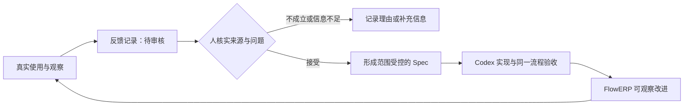

# L15｜生成交付摘要并采集真实反馈

交付页面已经能显示任务和业务结果，但接手者通常没有参与整个开发过程。他需要知道这次改了什么、依据什么接受、还有哪些限制。使用者随后提出的意见，也需要经过核实才能成为下一次需求。

本讲建设交付摘要与反馈机制，并据一条真实反馈完成 FlowERP 的范围受控改进。工作台由此开始把使用后的观察连接回下一次交付。

## 本章学习地图

先区分事实摘要与宣传性总结，再判断反馈能证明什么，随后将已确认问题转成改进任务，最后复验产品变化及反馈状态。

Codex 可以帮助提取证据、整理文字和提出修复方案；学生核对来源与业务取舍；工作台保存反馈、审核与改进的关联。FlowERP 必须产生可观察的实际改进，不能只新增一份反馈文档。

## 1. 一份摘要为什么可能误导？

“系统已全面优化，测试全部通过”没有告诉接手者优化了什么、运行了哪些测试，也没有说明尚未检查的部分。文字越确定，读者越容易把有限结果理解成全面保证。

更有用的摘要从变更事实出发：采购申请现在会保留申请原因；检查覆盖创建、查询和重启后读取；未修改审批与付款流程；本次报告与源码版本可在任务中找到。

摘要不是新的证据来源，而是已有证据的索引。Codex 生成后，要逐条确认它是否能回到实际记录，特别留意“全部”“无风险”“已经发布”等容易扩大结论的表述。

## 2. 用一个使用反馈推导改进

设想采购人员反馈：“看到申请后，不知道为什么要采购这批商品。”这是教学情境，用于说明分析方法；正式作业需要采集实际使用者或同伴试用的反馈，并注明来源，不能把示例当成真实访谈。

先核实问题发生在哪一步。申请原因可能没有保存，也可能已经保存但详情页未展示，还可能是使用者找不到入口。三种原因需要不同改进。直接接受“增加一个智能采购助手”的建议，会过早扩大范围。

如果原因已经保存但页面遗漏，本次可以只在申请详情展示它，补充空值行为和查询检查，再请原反馈者复验。这一小改动把观察、诊断、实现与效果连接起来，比笼统承诺“改善体验”更容易判断。

## 3. 反馈为何先进入待审核？

原始反馈表达使用者的经历或判断，可能不完整，也可能包含错误归因。工作台应保存来源、关联任务、观察内容与建议下一步，再由人确认是否成立及是否进入当前范围。



仓库的 `workbench/feedback.py` 将新反馈置于待审核状态，并保存来源、结论与下一步。接受或拒绝需要记录审核人；已有审核结果不能被重复请求随意覆盖。

自动检测到任务失败，也可以生成待审核观察，但不能自行把观察升级为业务规则。尤其不能把一句原始反馈直接变成阻断 Eval：必须先确认适用范围、预期结果和反例，否则下一次正常业务可能被错误阻断。

## 4. 怎样避免反馈变成无限需求池？

对每条反馈，先判断影响、频率与可复现性，再决定处理方式。有些应立即修复，有些需要补充信息，有些属于下一阶段范围。保留拒绝或延期原因，可以避免同一个问题反复从头讨论。

重复反馈也不应简单删除。可以关联到同一问题，同时保留来源数量与差异，因为多个独立观察可能改变优先级。去重的目标是避免重复执行，不是抹去使用事实。

一次改进是否有效，应由原问题的观察验证。不能用新增代码量、生成摘要字数或用户笼统满意来代替具体结果。


图中把反馈与后续改进联系起来。记录“已经改进”仍需引用实际任务与验收，不能由状态名称自行证明效果。

## 5. 实践：完成一次反馈驱动的交付

请一位同伴或实际使用者在自己的演示环境执行采购、销售、库存或财务中的一项操作。保存经允许记录的观察，避免收集无关个人信息；测试情境和真实业务使用要如实区分。

先由你复现，再请 Codex 协助提出原因与最小方案。形成 Spec，写出改进前可见的问题，通过工作台交付，并让原反馈者用相同场景复验。

激活虚拟环境后，可查看当前反馈汇总：

```bash
python -X utf8 -m workbench.feedback summary
```

这个命令读取已有记录，不会替你完成访谈或审核。随后检查原始反馈没有绕过审核直接影响阻断规则：

```bash
python -X utf8 -m eval.harness --suite blocking --case raw_feedback_cannot_become_blocking
```

**正常路径**是反馈经核实接受，改进任务完成，使用者确认具体问题已解决。**失败路径**可以是无来源记录、缺少必要字段或重复审核。合理的**失败后状态**是请求被拒绝或仍待补充，原反馈和审核历史不被覆盖。

摘要可按以下结构撰写，内容必须来自本次真实记录：

```text
问题与来源：谁在什么操作中观察到什么。
本次变化：用户现在能完成什么，修改范围是什么。
验证依据：任务、版本、检查与实际使用复验。
已知限制：哪些场景尚未覆盖。
后续处理：已接受的下一步或明确的延期原因。
```

## 6. 复验与小结

提交反馈来源、复现、取舍、改进前后结果和摘要。**第二次签字**请同伴随机选一句摘要，沿引用找到证据；原反馈者的使用复验则回答问题是否实际得到解决。

迁移练习：两位使用者对同一功能提出相反建议，应该增加什么观察或分组，才能作出有依据的范围决定？

本讲形成现场问题、交付和能力改进的反馈循环。最后一讲将在干净环境中验证整套系统，并现场完成一个此前未实现的小需求。

## 配套实践与阅读

[行动卡](./tasks/L15-摘要与反馈.md) · [实践提示词](./labs/L15/prompts/README.md) · [提交模板](./labs/L15/SUBMISSION.md) · [课堂 PPT](<./slides/L15-生成交付摘要并采集真实反馈.pptx>)

## 附录 A：本讲课程大纲合同

以下保留课程大纲的四项约定，供完成学习后核对。本讲对应 CLO-6：交付、反馈与迁移。

- **核心内容**：文档和周报导出、运行反馈、失败样本回流，以及反馈与自动改代码之间的人工边界。
- **演示结果**：生成一次交付摘要并写入一条结构化反馈。
- **课内增量**：实现摘要导出和反馈记录，不在本节增加新的 Agent 编排。
- **通过标准**：摘要可追溯到任务和 Eval 报告；反馈包含来源、结论和下一步；原始反馈不会未经审核直接成为阻断 Eval。

## 本讲一手来源

> 核验日期：2026-09-04。来源用于解释机制，不改写课表主题、课程大纲合同或 FlowERP 通过标准。

- [OpenAI：Evaluation best practices](https://developers.openai.com/api/docs/guides/evaluation-best-practices)
- [Google SRE：Postmortem Culture](https://sre.google/workbook/postmortem-culture/)
- [CMU：Active Learning](https://www.cmu.edu/teaching/resources/instructionalstrategies/activelearningstrategies/index.html)

### 新需求不能借旧失败起跑

受控执行前，既有课程合同须全部通过，至少一个本次新增用例须真实失败。旧功能失败而新增用例通过、两组都失败或两组都通过，都会停止本次执行并保留原因。新增断言仍需由同伴核对其与实际 Spec 的关系，换名或环境故障不能冒充产品缺口。用四种起点完成首次预测、实际结果和修订对照，见[新增需求起始检查](../reference/L15-L16新增需求起始检查.md)。


### 本次需求必须进入执行合同

先将本次已审核需求保存为 `.runtime/l15-requirement.md`，使用来源、目标、非目标、约束、验收用例、完成定义六段结构；验收段明确列出本次新增 case。`course-spec` 生成的通用课程合同仅作范围参考，不能原样替代具体需求。提交时用 `--requirement-spec` 指向该文件。网页从已决定事项进入 L15/L16 时会绑定事项版本并直接生成合同。保存的任务目标应与本次需求一致；核对任务记录中的合同指纹、来源事项及真实 ERP 结果。详见[新增需求起始检查](../reference/L15-L16新增需求起始检查.md)。


维护案例：[空库存导出应保留列名](../reference/L15空库存导出维护案例.md)。可用它观察实际先红后绿、范围内改动与停在人审的证据；该维护记录不能代替你的真实反馈采纳和迁移任务。当前参考源码已修复，复跑全绿不算新交付。
